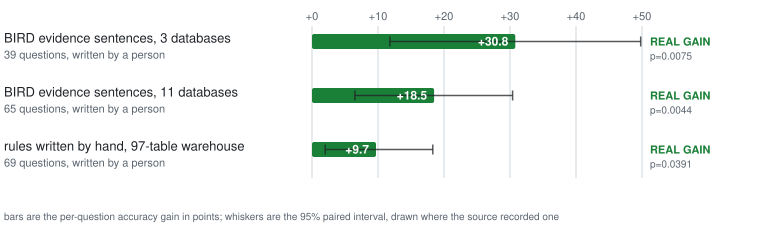
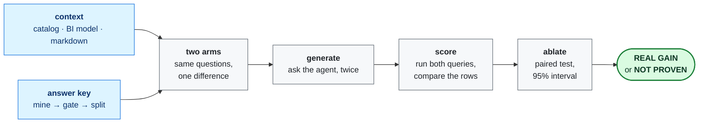

<div align="center">

<h1>contextlift</h1>

**Measure whether your written business context makes an AI SQL agent more accurate.**

[](https://github.com/moutasemalakkad/context-lift/actions/workflows/test.yml)
[](LICENSE)
[](pyproject.toml)

[Try it](#try-it) · [Quickstart](docs/QUICKSTART.md) · [Walkthrough](docs/WALKTHROUGH.md) · [Method](docs/METHODOLOGY.md) · [Results](docs/CASE_STUDY.md)

<picture>
  <source media="(prefers-color-scheme: dark)" srcset="docs/assets/results-dark.svg">
  
</picture>

<i>Every run this project has measured. Prose a person wrote pays, every time.<br/>
The same kind of metadata, read out of a BI tool by a machine, does not.</i>

</div>

## Try it

No API key. No network. About one second.

```bash
git clone https://github.com/moutasemalakkad/context-lift && cd context-lift
make example-bird
```

<!-- headline:example-bird -->
```
paired ablation on 39 questions (execution accuracy)
  without context :  30.8%  [18.6%, 46.4%]
  with context    :  61.5%  [45.9%, 75.1%]
  lift            : +30.8%  [+11.8%, +49.8%]
  context fixed   : 15 questions
  context broke   : 3 questions
  McNemar p       : 0.0075   significant at 0.05
  ruling          : REAL GAIN
```

## What that number is

Most of the accuracy in an enterprise text-to-SQL system does not come from the
model. It comes from someone writing down what the business means: the default
reporting grain, which rows to exclude, how each metric is defined. This tool
measures whether that writing-down was worth it.

The run above is 39 questions over three [BIRD](https://bird-bench.github.io/)
databases. Predictions are generated once and committed, so it prints the same
numbers on your machine as on mine. `tests/test_readme_numbers.py` recomputes
every figure in that block from those predictions and fails if the two ever
disagree.

**What made the difference.** BIRD ships one human sentence per question,
decoding a business phrase into a filter or a formula: *"meetings in 2020 refers
to type='Meeting' where YEAR(event_date)=2020"*. That sentence is not in the
schema. It is what a data catalog is supposed to hold, and writing it down
doubled the accuracy.

**What the verdict word is for.** `REAL GAIN` is printed only when the paired
test clears 0.05 on questions held back from curation. When a round cannot
resolve the effect it was looking for, the word is `NOT PROVEN` and the number
beside it is not a result. Expect to see both on your own data: that is the
tool working, not failing.

## Everything measured so far

| where the context came from | questions | lift | ruling |
|---|---|---|---|
| BIRD evidence sentences, 3 databases — `make example-bird` | 39 | 30.8% → 61.5%, **+30.8** | REAL GAIN, p=0.0075 |
| BIRD evidence sentences, 11 databases — `make example-bird-enterprise` | 65 | **+18.5** [+6.5, +30.4] | REAL GAIN, p=0.0044 |
| rules written by hand, 97-table warehouse — [`examples/beaver`](examples/beaver) | 69 | 5.3% → 15.0%, **+9.7** [+2.0, +18.3] | REAL GAIN, p=0.0391 |

Every lift above is **per question**, with its 95% paired interval. Answering
one question three times gives three answers, not three independent facts, so
a per-answer figure has a larger denominator and a narrower interval. The two
levels are not interchangeable, so this table uses one of them throughout.

Each row lives in [`docs/assets/results.json`](docs/assets/results.json) and
names the committed file its numbers come from, plus the test that pins that
file. `tests/test_results_chart.py` re-reads every source and fails if a row
and its source disagree, so the chart cannot drift from the data. Two larger
rows are described in [docs/CASE_STUDY.md](docs/CASE_STUDY.md) rather than
drawn here: a 596-question warehouse holdout, the same 11-database study read
per answer instead of per question, and a round on a BI model whose metrics
carried no written descriptions.

That last one answers the question every customer asks first — *can't you just
read my BI tool?* The answer turns on one number, the share of metrics with a
description, and `contextlift semantic --lookml <repo>` prints it for free
before anyone spends anything.

## How it works


Measured on a fresh clone: the **first** run takes about 14 seconds, because
`uv` builds the virtual environment and caches bytecode. Every run after that
is about 0.17 seconds. The recording above is a warm run.

That is `contextlift demo`: the whole loop on seven rows of data, with no key,
no cloud and no network. The model answers in it are canned and it says so on
screen; the warehouse, the SQL execution, the paired test and the verdict are
the real code. Re-record it with `make demo-gif`.



An *arm* is the same questions answered under one condition. Two arms differ
only by the context the model was given, so the gap between them is what the
context was worth. Eight commands complete one measurement:

| command | what it does |
|---|---|
| `doctor` | check the machine can do the run at all |
| `gate` | audit the answer key for defects, before anything is spent |
| `split` | set aside questions to be read once, at the end |
| `lint` | refuse context that cannot help, before paying for a round |
| `round` | generate, score and compare both arms in one command |
| `bundle` | write the run and its evidence to a single HTML file |
| `next` | read the workspace and print the exact command to run next |
| `demo` | the whole loop on a toy database, offline |

`contextlift --help` lists those eight. `contextlift --help-all` lists all 48.

**Three rules the tool enforces rather than suggests.** *Run every arm more than
once* — temperature 0 is not reproducible, and on one engagement no single
repetition reached significance while the pooled three did (p=0.031). *Baseline
before curation* — it is the only number showing what curation was worth, and it
cannot be recovered afterwards. *Hold questions out* — scoring on the questions
that guided your curation measures how well you fitted them, so `climb` warns
unless you pass `--holdout`.

## What gets compared

Not SQL text. SQL results. The predicted query and the gold query both run
against a database, and the row sets are compared under SQL semantics:
column-order independent, multiset unless the gold has `ORDER BY`, float
tolerant to 4 decimals, NULL-safe. Two queries written differently that return
the same rows count as a match. This is the Spider/BIRD *execution accuracy*
metric.

The `gate` runs upstream and is separate: it audits the answer key itself,
because one broken gold question silently corrupts every score after it.

## Install

```bash
make install                  # uv venv + editable install with dev deps, no cloud extras
source .venv/bin/activate     # the `contextlift` command lives here
make test                     # fast suite, no cloud, no key
```

`make test` runs green from a fresh clone with no credentials. That is checked
by `tests/test_fresh_clone.py`, not just claimed.

Every `make` target runs through `uv run` and works without activating. The
bare `contextlift` command does not — without that `activate` line, the first
command in either guide fails with *command not found*.

The core is Python standard library over SQLite. Cloud backends are optional:

```bash
uv pip install --python .venv/bin/python -e ".[bigquery]"   # --db bq://PROJECT/DATASET
uv pip install --python .venv/bin/python -e ".[gemini]"     # the LLM judge
uv pip install --python .venv/bin/python -e ".[catalog]"    # Google Knowledge Catalog
```

`--python .venv/bin/python` pins the interpreter. A `VIRTUAL_ENV` left over from
another checkout otherwise wins, and the extra lands there.

## Documentation

| read | when |
|---|---|
| [QUICKSTART](docs/QUICKSTART.md) | you want it running in three steps, the first one second long |
| [WALKTHROUGH](docs/WALKTHROUGH.md) | one real loop end to end, every command and its output |
| [ONBOARDING](docs/ONBOARDING.md) | you have a warehouse, an afternoon, and a blank file |
| [FORMATS](docs/FORMATS.md) | every CSV, JSON, `--spec` directory, and `--workspace` layout in one table |
| [PRACTICES](docs/PRACTICES.md) | thirteen practices, each printed beside the measurement that earned it |
| [METHODOLOGY](docs/METHODOLOGY.md) | why each number is computed this way, with citations and known limits |
| [CASE_STUDY](docs/CASE_STUDY.md) | every measured result, with the command that produced it |
| [ATTRIBUTION](docs/ATTRIBUTION.md) | how one written line gets credited or blamed for one question |
| [CONTEXT-SOURCES](docs/CONTEXT-SOURCES.md) | where each piece of knowledge belongs in a catalog, then the field notes from a live estate |
| [SECURITY-AND-DATA](docs/SECURITY-AND-DATA.md) | what leaves your estate and what does not |
| [COLD-RUN](docs/COLD-RUN.md) | proving the loop on a dataset nobody here has seen |
| [AUTHORING](docs/AUTHORING.md) | adding a warehouse or an agent: two protocols, and what a new one must not do |
| [ROADMAP](docs/ROADMAP.md) | what is wanted, and what is deliberately not planned, with the reasons |

`contextlift <verb> --help` is the reference for every verb and flag. It is
generated from the code, so it cannot disagree with the code.

Contributing: [CONTRIBUTING.md](CONTRIBUTING.md). Reporting a vulnerability:
[SECURITY.md](SECURITY.md). Everything runs offline, so `make install &&
make test` is the whole setup.

## Repo layout

```
src/context_lift/   the package: 48 commands, one per stage of the loop
tests/              the fast suite — no cloud, no key, no network
examples/           bird, beaver, thelook: each with its own README and runbook
docs/               methodology, results, security, and the two guides
scripts/            stage runners that are not verbs yet (LookML reader, convention miner)
docs/assets/        the README's chart and demo, and the script that draws them
deploy/             a Cloud Run job, for a round that outlives a laptop
```

## License

Apache-2.0. Copyright 2026 Moutasem Akkad. See [LICENSE](LICENSE) and [NOTICE](NOTICE).
