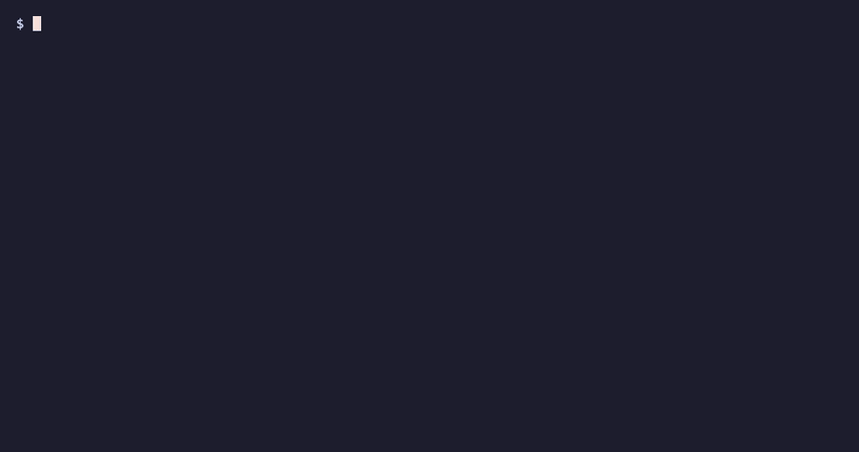
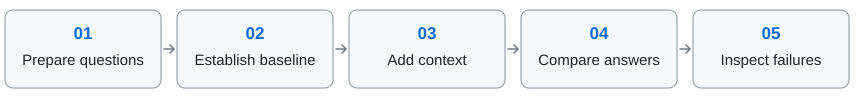

<div align="center">

<h1>contextlift</h1>

**Find out whether your business context makes an AI SQL agent more accurate.**

[](LICENSE)
[](pyproject.toml)

### [Start the guide →](docs/README.md)

*One path from installation to a final result, with best practices at every stage.*



*A toy warehouse with canned model answers; scoring and the paired test run locally.*
[Still frame](docs/assets/demo-still.png)

</div>

## What it does

A schema tells an agent which columns exist. Your context explains what
“revenue” means, which rows count, and how your team expects an answer.
contextlift measures whether those definitions help:

- Compare SQL answers with and without context.
- See accuracy lift, its interval, and the questions context fixed or broke.
- Use the failures to choose the next edit.

## Try it locally

Requires Python 3.10+, [uv](https://docs.astral.sh/uv/getting-started/installation/),
Git, and Make. Cloning and first-time setup need network access. The example
uses committed predictions and SQLite databases, with no API key or cloud calls.

```bash
git clone https://github.com/moutasemalakkad/context-lift
cd context-lift
make example-bird
```

Recorded comparison:

<!-- headline:example-bird -->
```
paired ablation on 39 questions (execution accuracy)
  without context :  30.8%  [18.6%, 46.4%]
  with context    :  61.5%  [45.9%, 75.1%]
  lift            : +30.8%  [+11.8%, +49.8%]
  context fixed   : 15 questions
  context broke   : 3 questions
  McNemar p       : 0.0075   significant at 0.05
  ruling          : REAL GAIN
```

The gain includes **3 regressions**. This small example uses one repetition
per arm and no reserved holdout. See the [broken IDs and qualifications](examples/bird/README.md#what-you-will-see).

## Follow the loop

<picture>
  <source media="(max-width: 600px)" srcset="docs/assets/workflow-stacked.svg">
  
</picture>

The **[guide](docs/README.md)** follows one workspace through eight stages:
setup, scope, review, split, baseline, context, iteration, and final holdout.
Each stage includes commands, expected output, and a check before continuing.

For a specific detail, use the [technical reference](docs/REFERENCE.md).
Recorded results and limitations live in the [research archive](docs/research/README.md);
benchmark reproduction starts in [examples](examples/README.md).

## Contributing

```bash
make install
make test
```

After installation, the tests run offline from a fresh clone without
credentials. [CI runs](https://github.com/moutasemalakkad/context-lift/actions/workflows/test.yml)
record the checks. [Contributing](CONTRIBUTING.md) covers development and backend
extensions. [Security](SECURITY.md) explains private vulnerability reporting.

## License

Apache-2.0. Copyright 2026 Moutasem Akkad. See [LICENSE](LICENSE) and [NOTICE](NOTICE).
