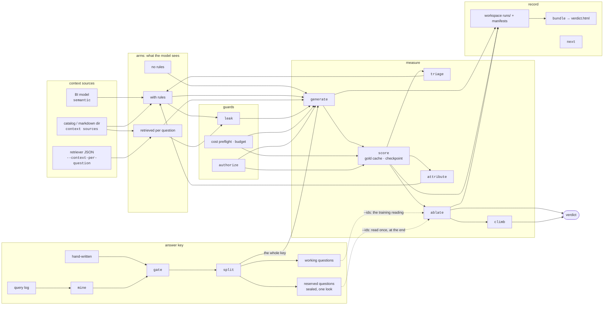

# Methodology

[Documentation](README.md) / Methodology

## On this page

- [1. Execution accuracy, not string match](#1-execution-accuracy-not-string-match)
- [2. Comparator semantics](#2-comparator-semantics)
- [2b. Extra columns, as a recorded option](#2b-extra-columns-as-a-recorded-option)
- [3. Exclusion rules](#3-exclusion-rules)
- [4. The LLM judge is one-sided — read this before trusting a number](#4-the-llm-judge-is-one-sided--read-this-before-trusting-a-number)
- [5. The gold-set gate audits the oracle](#5-the-gold-set-gate-audits-the-oracle)
- [5b. Mining a gold set out of a real query log](#5b-mining-a-gold-set-out-of-a-real-query-log)
- [6. Routing accuracy scores the table-picking stage on its own](#6-routing-accuracy-scores-the-table-picking-stage-on-its-own)
- [6b. Attribution: from "broke 3" to "this rule broke it"](#6b-attribution-from-broke-3-to-this-rule-broke-it)
- [6c. Two numbers per round, and only one of them is a guess](#6c-two-numbers-per-round-and-only-one-of-them-is-a-guess)
- [6d. `history`: one question across every round](#6d-history-one-question-across-every-round)
- [7. Statistics: Wilson interval and McNemar's test](#7-statistics-wilson-interval-and-mcnemars-test)
- [7b. Cost is measured, and estimated from a dated price table](#7b-cost-is-measured-and-estimated-from-a-dated-price-table)
- [8. Deliberately skipped](#8-deliberately-skipped)
- [9. Adding a warehouse backend](#9-adding-a-warehouse-backend)
- [References](#references)
- [The whole loop, in one diagram](#the-whole-loop-in-one-diagram)

Why this library measures what it measures, the alternatives rejected, and the
known limitations. The short version lives in the [README](../README.md); this is
the reference.

## 1. Execution accuracy, not string match

A text-to-SQL system is graded by *running* its SQL and comparing the result rows
to the gold query's rows — not by comparing SQL text. Two queries written
differently (a `JOIN` vs a subquery, a different column order, an extra harmless
`ORDER BY`) can return the same answer, and string match would wrongly call them
different. This is the metric used by Spider (Yu et al., EMNLP 2018) and BIRD (Li
et al., NeurIPS 2023).

The comparator (`compare.py`) is adapted from the reference implementation in
`taoyds/test-suite-sql-eval` (Zhong, Yu, Klein, EMNLP 2020,
https://aclanthology.org/2020.emnlp-main.29/).

## 2. Comparator semantics

Four rules, each tracking a fact about SQL:

| rule | why | rejected alternative |
|---|---|---|
| compare the **full** result set | a first-N sample produces false MISMATCH when both queries return many rows in different orders | sampling rows |
| **column order ignored** (search real column permutations, pruned by per-column value multisets, after a cheap per-row-sorted rejection filter) | `SELECT a, b` and `SELECT b, a` denote the same answer; O(c log c) per row | enumerating O(c!) column permutations |
| **multiset** semantics, switching to **positional** when the gold has `ORDER BY` | an unordered query is a set; an ordered query is a sequence | always-set (misses a broken `ORDER BY`/`LIMIT`); always-positional (false MISMATCH on unordered queries) |
| **floats rounded to 4 decimals** | `AVG`/`STDDEV` jitter across engines and across runs | exact float equality |

NULL is carried as a sentinel string so rows sort and hash cleanly; `NULL` is not
equal to `0` or to empty string.

What the comparator deliberately does **not** do:
- **Type coercion** — `1` and `"1"` compare as different (Spider matches this).
- **Column-name matching** — names are ignored; only values are compared.

Non-finite floats normalize to distinct strings ("inf", "-inf", a NaN
sentinel) instead of crashing: a real gold dividing by a zero-heavy column
made SQLite return Infinity, and int(inf) raises. +inf never matches -inf.

## 2b. Extra columns, as a recorded option

A prediction that returns the gold's columns plus more (`Country, COUNT(*)`
where the gold asked for `Country`) is wrong by default, the way Spider and
BIRD score it. `score --extra-columns tolerate` accepts it under a distinct
verdict, `MATCH_EXTRA_COLUMNS`: every gold column must be found in the
prediction with the same rows, duplicates included, so row counts still
have to agree and `SELECT DISTINCT a` never matches `SELECT a, id`. This is
the rule Spider 2.0 and Defog's sql-eval use. The risk of the tolerant rule
is padding: an arm that learns to add columns climbs without answering
better. So the report always prints the strict count beside the tolerant
one, and the option is recorded in the run's manifest.

## 3. Exclusion rules

Two outcomes are dropped from the denominator because they carry no signal about a
prediction:
- **EMPTY_BOTH** — gold and prediction both return nothing. Counting it as correct
  would reward a model that returns nothing; counting it wrong punishes a correct
  empty answer. The gate (§5) should remove empty golds first, so this is rare.
- **GOLD_ERROR** — the gold query itself failed to run; it can't grade anything.

A failed *prediction* is different: it is a real wrong answer and counts as
incorrect.

A **timed-out** query follows the same split. Executors accept
`timeout_seconds` because predicted SQL is untrusted model output and a
valid, read-only, index-using query can still never finish (a measured case
ran 20+ minutes; `row_cap` cannot bound it, since an ORDER BY does all its
work before the first row exists). A gold that times out is a TIMEOUT gate
defect and excludes the question; a prediction that times out is a wrong
answer.

## 4. The LLM judge is one-sided — read this before trusting a number

**WITHDRAWN 2026-09-12.** This section used to open: "Single-database execution
match has a false-negative rate: two genuinely equivalent result sets can differ
in a way the exact comparator can't reconcile (a full name vs a first name, a
representation difference). The test-suite paper (EMNLP 2020) reports this is
roughly 2.5% on average and up to ~8.1% in the worst case for single-DB
denotation match." The two figures exist in the paper, but they measure a
different metric in the opposite direction, so the sentences are withdrawn
rather than reworded.

What Zhong, Yu and Klein (EMNLP 2020, https://arxiv.org/abs/2010.02840) report,
read off the paper:

- **Table 1** is "The false positive/negative rate of the adapted exact set
  match metric", which compares SQL *text*. Section 6.2: "ESM leads to a
  non-trivial false negative rate of 2.6% on average, and 8.1% in the worst
  case." (The abstract rounds the same figure to 2.5%.) That is the 2.5 / 8.1
  pair this section quoted. It is about string match, which this library
  deliberately does not do (§1).
- **Table 2** is "The false positive rate of single denotation accuracy (i.e.,
  checking denotation only on the databases originally released in Yu et al.
  (2018))". All-data row: 6.5% mean, 9.0% max across the 21 Spider dev
  submissions. That is the metric `compare.py` implements, and the measured
  error is a false POSITIVE: single-database denotation called about 6.5% of
  the dev set correct where test-suite accuracy called it wrong, because a
  wrong query can return the gold's rows on one database by accident.
- The paper gives **no false-negative rate for single-database denotation
  match**. Section 8: "test suite evaluation provably never creates false
  negatives in a strict programming language sense."

So the only published error rate for this metric points the other way from what
this section claimed: single-database execution match scores too HIGH.

The judge keeps a reason to exist, a narrower one. Execution match can still
produce false negatives from the comparator's own choices rather than from SQL
semantics: column names are ignored, types are not coerced, floats round to 4
decimals (§2). No one has measured that rate, in this repo or in the paper. Read
the judge as a hedge against our comparator, not as a fix for a number from the
literature, and read the one-sidedness below knowing the metric's published bias
is already upward.

The optional judge is the cheap partial fix from FLEX (Kim et al., NAACL 2025,
https://arxiv.org/abs/2409.19014): an LLM looks at the cases the comparator
already flagged wrong and decides whether they are actually equivalent.

**The limitation, stated plainly:** the judge is one-sided. It runs only on the
MISMATCH/EMPTY_ONE residual, and only an `EQUIVALENT` verdict upgrades a row to
correct. It never re-checks a MATCH. So it can only **raise** the reported score,
never lower it. A judge-adjusted number is therefore an *upper-leaning* estimate.

For a headline number you defend, do a **two-sided human audit**: sample MATCHes
too (the judge never sees those), and report inter-rater agreement (Cohen's kappa)
between the human and the automated verdict. The judge reduces comparator-side
false negatives; it does nothing about the false positives measured above, and it
does not certify the score.

The judge is also **fail-safe**: any backend error (timeout, bad key, quota)
returns an empty verdict and leaves the row wrong, never raises. One dead call must
not take down a long run.

## 5. The gold-set gate audits the oracle

Every accuracy number is computed against the gold queries, so a broken gold
silently corrupts the metric. The gate (`gate.py`) runs each gold through an
executor and flags:

| defect | meaning |
|---|---|
| `NON_SELECT` | not a read-only SELECT/WITH |
| `PLACEHOLDER_COMMENT` | empty after stripping comments, or carries a TODO/FIXME marker |
| `EXEC_FAIL` | raises when executed: the SQL itself is wrong |
| `OVER_BUDGET` | the byte ceiling turned the query away before it ran; raise `--max-bytes` |
| `NO_ACCESS` | the platform refused the call (403); whoever owns the policy fixes it |
| `TABLE_GONE` | names a table that no longer exists; drop the gold |
| `ZERO_ROWS` | returns no rows (often a wrong filter or stale data) |
| `DEGENERATE` | a single trivial cell (NULL or 0) |
| `TRUNCATED` | hit the executor row cap |
| `UNSTABLE` | two runs returned different rows (opt-in; doubles cost) |
| `CROSS_PROJECT` | names a project `--db` does not read |
| `WHOLE_ROW` | the outermost query is `SELECT *`: a browse, not a question |
| `MISSING_LITERAL` | the question omits a business CODE the gold filters on. A warning: omitting it is what `--rules-in-context` is for |
| `MISSING_PARAMETER` | the question omits a PARAMETER the gold filters on - a date, a period, an id. A defect: no context can supply which month was meant, so the gold is wrong in both arms forever |

`EXEC_FAIL` used to be one label over four different people's problems, and
the label sent a day in the wrong direction. On one enterprise warehouse 179
of 446 candidates came back `EXEC_FAIL`, which reads as "your query log is
junk". Reading all 179 details said otherwise:

| what really happened | rows | who fixes it |
|---|---|---|
| the byte ceiling turned it away before it ran (1 GB default) | 112 | raise `--max-bytes` |
| the platform refused the call, 403 from VPC Service Controls | 34 | whoever owns the org policy |
| the query named a table dropped since the analyst ran it | 24 | nobody; drop the gold |
| the SQL is genuinely wrong (`@param`, unqualified table, dead column) | 9 | the query's author |

170 of 179 were not the SQL's fault, and the true headline was "112 of these
are one `--max-bytes` raise away". So they are four classes now, each named
for what recovers it. `TIMEOUT` had already been split out for exactly this
reason, which is the precedent.

`mine` prints what recovers each class beside its count, and a measured
ladder for the ceiling built from the dry-run figure the refusal text already
carries, so it costs nothing to compute:

```
  what raising --max-bytes would buy (it was 1 GB):
    --max-bytes 10     GB   61 of 112 come back, 0.28 TiB to run once, ~$1.74
    --max-bytes 200    GB   93 of 112 come back, 2.08 TiB to run once, ~$12.99
    --max-bytes 2000   GB   111 of 112 come back, 20.55 TiB to run once, ~$128.45
    one shape wants 29,546 GB on its own, 17x the next largest (1,765 GB): a
    ceiling that includes it is paid for one gold
```

That last line matters: without it a person reads "111 of 112 at 2000 GB" and
pays $128 for one extra gold.

`CROSS_PROJECT` is not a failure to run: the gold runs, returns rows and
passes every other check. `--db` says where the run reads, the mined SQL
carries its own fully-qualified names, and when they disagree the answer key
comes from another copy of the data. It stays a flag and not a hard reject
because a rewrite is often the right answer: of 5 found on one pass, 3 did
not exist in the `--db` project and 2 rewrote cleanly. A two-part
`dataset.table` names no project and resolves where the run reads, so it is
never flagged.

`WHOLE_ROW` is the same kind of flag: it runs and returns rows, and it is
never clean. 12 of 32 golds mined from one estate's history were `SELECT *`,
and five of those failed on the column count alone (151 columns against the
agent's 8, 186 against 178, 56 against 1). Nobody asks a business question and
wants 151 columns back, so the row was someone browsing a table. Neither
`--extra-columns` setting rescues it: `tolerate` accepts a superset, and here
the prediction is a subset. The check reads the outermost projection, so a
star inside `COUNT(*)` or in a subquery is not it, and a `WITH` does not hide
one; `SELECT * FROM (SELECT id, day FROM orders)` is not it either, because
those columns are written down in the query.

`MISSING_LITERAL` reads the other half of the answer key. A gold is a pair,
and until now the gate audited only the SQL. On one field key of 25 mined
golds, 14 filtered on a literal the question text never gave: one question
read "for a specific product and planning group" while its gold pinned two
exact codes, another gold pinned four order numbers the question never named.
Add 6 browse golds and 3 with a row limit and no ordering, and 23 of the 25
could not be answered by any agent. The run read 0.000 with context and 0.000
without, and that number was a measurement of the key, not of the agent.

The check takes the string and number literals out of `WHERE`, `HAVING`,
`QUALIFY` and `JOIN ... ON`, and reports the ones the question does not carry.
Both sides are compared with everything that is not a letter or a digit
removed, so `PRD-1042`, `prd 1042` and `PRD1042` are the same value. Four
things are left out on purpose: `LIMIT` and `OFFSET` (a row cap is not a value
anyone asks for), a one-digit number (`is_deleted = 0` is a flag, and one
digit matches by accident inside any longer number), a date format such as
`'%Y-%m-%d'` (it tells a function how to read a date; a `LIKE` pattern like
`'%blue shirt%'` is a value and stays), and anything inside a comment. A date
range the question describes in words ("last January") does not match the
literal and is reported; the reviewer decides. The flag needs the question
text, so a gold list loaded as `(id, sql)` pairs is audited exactly as before,
and `mine` is where it fires today.

`DEGENERATE` is distinct from `ZERO_ROWS` for a reason worth stating: an aggregate
over an empty set returns *one* row, not zero. `SELECT SUM(x) FROM t WHERE <never>`
yields `[{None}]`, which `ZERO_ROWS` would miss — `DEGENERATE` catches the
non-answer.

## 5b. Mining a gold set out of a real query log

A warehouse's query log is the only source of questions that are actually
asked. It is also full of things that look like questions and are not, and
every class below was found by running the pipeline on one enterprise estate
rather than by reasoning about it.

**There is no published recipe for this.** Checked 2026-09-11: Spider 2.0 is
sourced from industrial applications, BEAVER from enterprise warehouses, and
newer work (BIRD-Ent, Spider-Ent) argues all of them are still too idealised
— but none documents mining and filtering a production query log. So the
filters below are not a reinvention of a known method; they are evidence from
one estate, and the numbers are given so somebody can disagree with them.

### What a log holds that cannot be a gold

| class | why it cannot be a gold | measured |
|---|---|---|
| a dashboard tile | runs hundreds of times for one viewer, so traffic ranking puts it first; no rule changes `SELECT ANY_VALUE(latest_week)` | 2.5% of 1.2M SELECTs joined 2+ tables and aggregated |
| machine-written SQL | dbt, Looker and CI prepend a header; the query is a model build | 31 of 2,000 shapes |
| **a migration or reconciliation check** | compares one copy of the data to another; no rule changes "compare these and say pass or fail" | **32 of 89 usable candidates (36%)**, 65 of 344 shapes (19%) |
| a freshness lookup | `SELECT MAX(fiscal_week)` has one right answer whatever the context says | seen throughout |

The first two have filters that predate this section. The third is
`compares_two_copies`, and it needs **two** signals of three — a copy-shaped
table name, a PASS/FAIL or `_diff` projection, a row-count reconciliation —
because in a warehouse where staging is where the data lives, a single `stg_`
name is everywhere and dropping every query that touches one throws away real
work. Scored against a person's own labels on 40 rows: 9 caught, **0 wrongly
flagged**, 13 missed. The misses are cross-*system* reconciliations, which
need knowing which names are systems and do not generalise.

**Push every filter into the log SQL, not the miner.** Same warehouse, same
window, same 2,000-row limit: the export went from 42 analytical shapes (2%)
to 1,494 (75%) for about ten cents, because the view is scanned either way.
A filter applied after ranking-by-traffic has already lost.

### The question must omit the rule and keep the parameter

With `mine --rules-in-context` the drafted question deliberately leaves out
the values the gold filters on, because a question that states the business
rule hands it to the bare arm for free and no written context can then show a
lift. That is right for a business **code** and fatal for a question
**parameter**:

- `company_code = '1000'` meaning Chile — a **rule**. Omitting it is the
  measurement.
- `ship_date = '2026-04-01'` — a **parameter**. No context tells an agent
  which month was meant, so the gold scores wrong in **both** arms and
  dilutes the lift exactly as a dashboard tile does.

The column decides, not the value: `company_code = '1000'` and
`fiscal_period = '2026007'` are both short digit strings. Sentinel dates are
excluded — `BETWEEN '1900-01-01' AND '9999-12-31'` is an open range written
as a closed one, and an agent writing no date filter returns the same rows.

On 39 clean golds from one estate: 24 omitted nothing, 11 omitted only codes,
3 omitted a parameter. A person reading all 39 by hand got the same 3.

## 6. Routing accuracy scores the table-picking stage on its own

In a warehouse with many tables, a text-to-SQL pipeline usually has a routing
stage first: pick the one `dataset.table` that should answer the question, then
write SQL against it. A routing miss guarantees a generation miss, so folding
both stages into one end-to-end number hides *which* stage failed. `score-routing`
grades routing separately, as single-label top-1 classification.

**Two tiers, not one.** Most routing misses land in the right dataset but the
wrong table; a single exact-match rate hides that, and the fix differs (better
table descriptions vs. better dataset scoping). So the report carries both
**dataset accuracy** (the part before the first dot matches) and **table
accuracy** (exact `dataset.table` match).

**Normalization before comparison.** Model output arrives with decoration that
should not count as a miss: surrounding quotes or backticks, a `bigquery:`
prefix, a 3-part `project.dataset.table`. Both sides are reduced to a canonical
2-part name; comparison stays case-sensitive because warehouse table names are.

**Empty predictions are misses, never exclusions.** The SQL harness excludes
GOLD_ERROR and EMPTY_BOTH because they carry no signal about the prediction
(§3). Routing has no analogue: a router that returns nothing gave a real wrong
answer, so the denominator is always the full question count. A broken routing
*gold* raises instead of being excluded — the gold is a single table name and
cheap to fix.

**Catalog snapping is opt-in and always reported.** A model that generates the
table name freely can blend two real names into one that does not exist. With
`--catalog` (the set of valid names), a near-miss prediction snaps to the
closest valid name (difflib similarity, cutoff 0.8) before scoring. This
recovers the model's evident intent but raises the number, so the report always
prints the snapped count, and the flag defaults to off. Two runs are only
comparable when they agree on whether a catalog was used — the rejected
alternative, always-on snapping, produces numbers that silently disagree with
un-snapped ones.

**Multi-table routing** (`--multi`) scores table SETS, because enterprise
questions rarely route to one table (measured on BEAVER DW: 120 of 121
questions need 2-7). Three rates: full coverage (every gold table predicted
- the one that matters, since one missing table guarantees a wrong join),
exact set equality, and recall pooled over individual gold tables.

## 6b. Attribution: from "broke 3" to "this rule broke it"

`ablate` keeps the ids behind its disagreement counts, and `attribute` maps
each flipped question to the context rules that plausibly caused it: parse
the context into `- "phrase" -> TABLE.COLUMN` rules, diff the two arms' SQL
at the identifier level, and suspect the rules mentioning what the context
INTRODUCED into that question's SQL. Deterministic and free.

A suspect is a lead, not a verdict - two rules naming the same table are
indistinguishable, and a rule can break a question without adding an
identifier. The confirmation is leave-one-out: re-run the arm with one
suspect removed. Running that for every rule costs one arm per rule, so the
report narrows to a shortlist first - the same reduction shape as AttriBoT
(arXiv 2411.15102) and ProCut (arXiv 2508.02053). Flips no rule explains
are reported unattributed rather than guessed at.

**Worked-example banks and leakage.** Retrieved question->SQL examples (the
"verified queries" of production systems) were the strongest context lever
measured, and also the easiest way to cheat accidentally: benchmark suites
are template-expanded, so a pool question can be a scored question's answer
with different literals. `curate-examples` therefore rebuilds the bank in a
loop - retrieve, run the leak check (normalized substrings, literals
masked), ban carriers, repeat - until clean, and reports the ban count. A
pool that is nothing but twins yields a clean empty bank, never a leaky one.

### Three signals, not one

An introduced identifier is not the only way a rule changes SQL. On a real
run, `- "under construction" -> plants.Status` made the model write
`Status = 'under construction'`, the phrase as a value in the wrong case,
while `Status` was already in the baseline SQL; the identifier signal
missed it. `attribute` now marks a rule as a suspect on any of three
signals and names them: `introduced_identifier`, `phrase_in_literal` (the
rule's phrase appears inside a string literal the with-context SQL added),
and `literal_changed_on_rule_column` (a predicate on one of the rule's
columns carries a different literal in the two arms, compared as written,
case included). A signal is a lead; the confirmation is still a
leave-one-out arm. The cheapest cure for the whole class is `contextlift
profile`: the exact values each category column holds, read from the
database and given to the model as context, so it stops guessing spellings.

## 6c. Two numbers per round, and only one of them is a guess

A round reports a lift and a safety word, and they answer different
questions.

The **lift** is a claim about questions nobody has seen. It is an estimate,
so it carries an interval, a p-value and a verdict word, and on a small set
the honest word is UNDERPOWERED or NOT PROVEN.

The **safety word** is a count of what happened to the questions in front of
it. Nothing is estimated, so there is no test and no interval. `SAFE` means
no question that was right without the context became wrong with it.
`MIXED` means more were fixed than broken. `REGRESSION` means the breaks
equal or outnumber the fixes. The word is true at any set size, including a
set far too small for any lift to be proven.

So a round can read NOT PROVEN and SAFE at the same time, and that is the
common state early in a project. It says: this context does not yet have
enough evidence behind it, and keeping it costs nothing.

Both come from `per_question`, one entry per base question, never from the
rep-suffixed id lists. Three repetitions of one question are one question,
and counting the ids would report a single flip as three broken questions.
An `unstable` question - one that flips between repetitions of the SAME arm
- is counted apart from a broken one, because a flip on unchanged context is
instability and not damage. This is the flaky-versus-broken distinction from
test-suite practice, where a test failing every run is a bug and one failing
sometimes is a flake, and the two need different work.

`safety_word` is one function called by the terminal, the HTML page and the
round ledger. Before it, `round.py` printed the pooled McNemar counts while
the page printed the clustered ones, so a single round could show two
different break counts on two surfaces.

## 6d. `history`: one question across every round

Per-round output says "5 fixed, 0 broke". It does not say whether question
`q014` has been broken once, three rounds running, or never. At thirty
questions a person holds that in their head. At a thousand they cannot.

`contextlift history --out history.csv` pivots the per-question statuses every
round already saved: one row per question, one column per round, plus
`first_broken_in`, `times_broken`, `times_unstable`, the blamed rule, and
whether the answer key is flagged. Nothing new is recorded and no cloud call
is made.

The terminal prints four counts that are exclusive and sum to the question
count - broken in the newest round, fixed and still fixed, unstable in the
newest, never moved - then two that cut across them: how many have been
broken in more than one round, and how many have a flagged answer key. A
question broken repeatedly is a rule to fix. One broken once and right since
is history. Sorting them together is how a real regression gets buried.

Rows are ordered by what needs work, not by id. The file is a CSV rather
than a page because the person reading it sorts and filters for a living.

Why this scales: nobody reads a thousand rows. A round over a thousand
questions might move thirty, and thirty is reviewable. The rest is "right
both ways" and "wrong both ways", and those rows should never reach a human.

## 7. Statistics: Wilson interval and McNemar's test

An accuracy like 19/35 is a point estimate from a noisy process; a 35-question
sample can barely pin it down. So every rate ships with an interval, and two
systems are compared with a paired test rather than by eyeballing which number is
bigger.

- **Wilson score interval** (Wilson, 1927) instead of the normal approximation
  `p ± z·√(p(1−p)/n)`. The normal approximation produces impossible bounds (<0 or
  >1) near the extremes and is too narrow at small n; Wilson inverts the score test
  and stays inside [0, 1].
- **McNemar's exact test** (McNemar, 1947) for comparing two systems on the same
  questions. Only the discordant pairs (one system right, the other wrong) carry
  signal; the exact binomial is used (not the chi-square approximation) because
  eval disagreement counts are usually small.

**Why hand-rolled, not statsmodels/scipy:** `statsmodels.proportion_confint(method=
"wilson")` and `contingency_tables.mcnemar(exact=True)` give identical numbers, and
for a one-off script they'd be the right call. But this is a library others install,
and statsmodels pulls scipy + numpy + pandas to provide ~40 lines of math — which
would make `make test` and `make example` require the whole scientific stack from a
fresh clone (and in some locked-down environments that stack isn't reachable). The
pure-stdlib core keeps the install story to "Python 3.10+". The risk of hand-rolled
stats is subtly-wrong math, so the numbers are pinned to a published reference
(Wilson 19/35 → [0.382, 0.695]) and an optional parity test asserts equality with
statsmodels when it happens to be installed. The inverse-normal CDF is Acklam's
rational approximation (accurate to ~1.15e-9), so no SciPy is needed for the z
multiplier.

**Pooled repetitions are not independent observations.** Repetitions of one
question share that question's difficulty, so pooled discordant counts
overstate the independent evidence (measured on real data: 10 pooled
discordant pairs collapsed to 5 under question-level majority vote, and one
question that flipped in opposite directions across reps contributed two
pooled "observations" of pure noise). The report therefore prints the
clustered-by-question test beside the pooled one; treat the clustered line
as the number to defend. Ties (a question flipping in exactly half its reps)
abstain from the clustered test.

**A comparison with no resolution still has something to report.** When no
answer is correct in either arm, or no question changes correctness, McNemar
has nothing to work with and `ablate` prints "the arms never disagreed" —
true about correctness, and it reads as "nothing happened". In one field round
five of eighteen questions stopped returning empty results and two started
while execution accuracy read 0.000 before and 0.000 after. So the report also
counts each arm's failures by `triage` bucket and prints the two tallies side
by side in exactly those two cases, with a line saying the score has no
resolution here. The shapes are triage's own names, not a second vocabulary,
and they are a description of what moved, never a verdict: a question that
stops erroring and starts returning wrong rows is still wrong.

## 7b. Cost is measured, and estimated from a dated price table

`generate` is the only paid command. Before its first call it builds every
prompt it will send and counts their tokens with the backend's own counter
(no model call), multiplies by the repetitions, and prices the total from a
table in `backends.py` that carries an `as_of` date. Output tokens are the
one guess: a default of 80 per call until a recorded run exists in the
workspace, then the measured mean of that run's output plus thinking
tokens. After the run, the actual token counts the API returned are priced
the same way and stored in the run manifest, so the next estimate learns
from them.

The price table is a fact about a date, not about the tool. When a model
is missing or a price has changed, `--input-price`/`--output-price` set
the rate for that run and the manifest records which numbers were used.
A `--budget` is enforced twice: the run refuses to start above the
estimate, and the backend stops answering once actual spend reaches the
ceiling, so a wrong estimate can overshoot by at most one call per worker.

## 8. Deliberately skipped

- **Test-suite accuracy** (perturbed database copies, EMNLP 2020) — the rigorous
  fix for the 6.5% mean false-POSITIVE rate of single-database denotation match
  (§4, Table 2 of that paper). It needs many DB copies per question and is out of
  scope. The one-sided judge is not a substitute: it can only raise a score, and
  a false positive needs the score lowered.
- **Type coercion and column-name matching** in the comparator (§2).
- **Recall@k and MRR for routing** (§6) — those grade a ranked candidate list;
  this scorer grades the single table the router committed to. If the pipeline
  retrieves candidates before picking, retrieval recall is a separate
  measurement.
- **Multi-label routing golds** — a question answerable from two tables scores
  as a miss unless the gold names the picked one. One gold table per question
  keeps the answer key auditable; questions that genuinely have two right
  answers belong in the gold set twice or not at all.

## 9. Adding a warehouse backend

`Executor` is a structural Protocol (`executor.py`): a class satisfies it by
having a matching `execute` method, with no import from this package and no
inheritance. That is deliberate — a backend can live in your code, ship in a
different package, or wrap a client this project has never heard of.

The whole contract:

```python
def execute(self, sql: str) -> ExecResult: ...
```

`ExecResult` carries `rows` (list of dicts, one per row), `error` (None if the
statement ran), and `truncated` (True if a row cap cut the result off). "Ran but
returned nothing" and "failed to run" must stay distinct — the gate treats them
as different defects, and collapsing both to `[]` hides a broken gold.

A sketch for Cloud Spanner, to show the shape:

```python
class SpannerExecutor:
    """Executor over Cloud Spanner. Read-only, single-use snapshots."""

    def __init__(self, instance_id: str, database_id: str, project: str | None = None):
        from google.cloud import spanner          # lazy: keeps the core stdlib-only

        client = spanner.Client(project=project)
        self.database = client.instance(instance_id).database(database_id)

    def execute(self, sql: str) -> ExecResult:
        if not is_read_only(sql):                 # reuse the guard, do not rewrite it
            return ExecResult(error="rejected: statement is not read-only")
        try:
            with self.database.snapshot() as snapshot:
                result = snapshot.execute_sql(sql)
                columns = [f.name for f in result.fields]
                rows = [dict(zip(columns, row)) for row in result]
            return ExecResult(rows=rows)
        except Exception as exc:                  # an engine error is a verdict, not a crash
            return ExecResult(error=str(exc))
```

Three things every backend must get right, learned from the two that ship:

**Never raise.** An engine error is a result the harness records, not an
exception that kills a run. `BigQueryExecutor` catches everything and returns it
in `error`.

**Enforce read-only yourself.** `is_read_only` from `executor.py` is the shared
check; call it before touching the engine. Model output is untrusted input.

**Put a ceiling on cost.** `BigQueryExecutor` dry-runs every query and refuses
anything scanning past a byte limit, because an eval run executes hundreds of
queries and one bad `JOIN` can be expensive. Spanner bills differently, so the
equivalent is a timeout and a row cap.

Declare the dependency as an optional extra so the core install stays free of
it:

```toml
[project.optional-dependencies]
spanner = ["google-cloud-spanner>=3.0"]
```

**What the CLI does with a warehouse backend.** `backends_db.make_executor`
maps a `--db` value to a backend: a path is SQLite, `bq://BILLING_PROJECT
[/DATA_PROJECT.DATASET]` is BigQuery. A new backend gets a new scheme there
and nothing else in the CLI changes. Two optional methods make the cost
rule work; a backend without them runs with no estimate line, as SQLite
does:

- `estimate(sqls, workers=1) -> {"queries", "bytes", "billable_bytes",
  "usd", "failed"}` dry-runs every distinct read-only statement without
  executing, `workers` at a time. Every SQL command calls it before its
  first query and prints the line; `--budget` refuses above it and
  `--estimate-only` stops there. The CLI times those dry-runs and prints a
  second line (queries, seconds per query, minutes at `--workers`), leaving
  out any gold the gold cache already answers. When the stage also makes
  model calls, that line counts them and says they are the clock: `mine
  --write-questions` drafts one question per shape, and on one estate the
  437 model calls took 42 minutes while the queries took under four. The
  line used to read "about 2.4 minutes".
- `usage = {"queries", "bytes_processed", "bytes_billed",
  "elapsed_seconds"}` counts what the executed jobs reported and the
  wall-clock time from the first call to the last; the CLI prints it after
  the run and writes it into the manifest as `telemetry`, with `workers`.

The BigQuery backend also settles five things a warehouse forces:

- **Cache on** (`use_query_cache=True`). The comparison is over rows, and a
  fixed SQL text over fixed data returns the same rows from the cache as
  from the engine, so the verdict cannot change; a job served from the
  cache bills nothing and returns in well under the server's time. The one
  command that wants two real runs, `gate --check-stability`, turns it off.
- **One client per thread, and a dry-run remembered per SQL text.** On a
  corporate mTLS network a client's SSL context serves exactly one
  connection, so one client shared by threads fails with "Context has
  already been used to create a Connection"; a client per thread keeps its
  own connection, and the call that hits that message once is retried on a
  fresh client. Each statement is dry-run once, so the estimate's dry-run
  is not repeated by `execute`. Measured: about 3 s per round trip through
  a proxy for 0.2 s of server time, and a 164-question three-rep arm at
  about 50 minutes one query at a time, which is why `--workers` (default
  4 on BigQuery) exists and why the harness runs each distinct SQL text
  once.
- **Timeout as its own verdict.** `job.result(timeout=)` plus a server-side
  `job_timeout_ms`; the error string starts with `timeout:` like SQLite's,
  so `gate` files it as TIMEOUT and `triage` as its own bucket, not as
  DID_NOT_RUN. Fixing a slow query and fixing a broken one are different
  jobs.
- **A friendly refusal at the byte ceiling.** A query the dry-run puts over
  `--max-bytes` gets `rejected: the query would scan more than the N GB
  ceiling`, naming the limit and the flag, instead of the engine's error.

Prices come from a dated constant (`executor.BIGQUERY_USD_PER_TIB`, with
the URL and the read date in the comment), the same rule as the model price
table in section 7b: a number the code prints must say where it came from.

No Spanner backend ships here. An untested backend in the package is worse than
a documented recipe: it looks supported and nothing proves it works.

## References

- Yu et al. Spider: A Large-Scale Human-Labeled Dataset for Complex and
  Cross-Domain Semantic Parsing and Text-to-SQL Task. EMNLP 2018.
- Li et al. Can LLM Already Serve as a Database Interface? A Big Bench for
  Large-Scale Database Grounded Text-to-SQLs (BIRD). NeurIPS 2023.
- Zhong, Yu, Klein. Semantic Evaluation for Text-to-SQL with Distilled Test Suites.
  EMNLP 2020. https://aclanthology.org/2020.emnlp-main.29/
- Kim et al. FLEX: Expert-level False-Less EXecution Metric for Reliable
  Text-to-SQL Benchmark. NAACL 2025. https://arxiv.org/abs/2409.19014
- Wilson, E. B. Probable Inference, the Law of Succession, and Statistical
  Inference. Journal of the American Statistical Association, 1927.
- McNemar, Q. Note on the Sampling Error of the Difference Between Correlated
  Proportions or Percentages. Psychometrika, 1947.

## The whole loop, in one diagram

The README shows the spine. This is every stage, every guard and every
record the loop writes. Read it left to right.



Read left to right. Context comes from somewhere on the left and becomes an
arm - the same questions answered under one condition. The answer key is
checked before anything is spent, and part of it is sealed. Every arm is
generated, scored and compared by the commands in the middle, each one behind
the guards below it. Everything a command does lands in the workspace on the
right, and `next` reads that record to say what to run.


[Documentation index](README.md) · Next: [Practices and evidence](PRACTICES.md)
