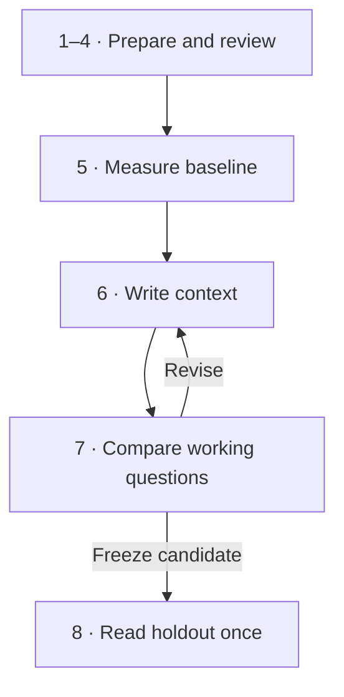

<!-- SPDX-License-Identifier: Apache-2.0 -->
<!-- SPDX-FileCopyrightText: 2026 Moutasem Akkad <moutasemalakkad@gmail.com> -->

# From first run to a defensible result

Measure whether written business context improves your SQL agent, then find
what to change. Follow this page in order. Each stage tells you what to bring,
what to run, what to expect, and when to continue.

**Two terms:** a *gold* is a reviewed question and its correct SQL; an *arm* is
that question set answered under one condition, such as with or without rules.

## The route

| Stage | You finish with |
|---|---|
| [1. Install and try the example](#1-install-and-try-the-example) | A local result you can explain |
| [2. Choose a workload](#2-choose-a-workload) | A scoped database and query sample |
| [3. Review the answer key](#3-review-the-answer-key) | Questions a person has checked |
| [4. Gate and reserve a holdout](#4-gate-and-reserve-a-holdout) | A clean key and a fixed split |
| [5. Measure the baseline](#5-measure-the-baseline) | Three scored runs without context |
| [6. Write context from failures](#6-write-context-from-failures) | Reviewed rules with a clear scope |
| [7. Compare and iterate](#7-compare-and-iterate) | A candidate tested on working questions |
| [8. Read the holdout and report](#8-read-the-holdout-and-report) | One final comparison and its caveats |



The [technical reference](REFERENCE.md) explains flags, statistics, catalogs,
and data handling when you need them. Dated measurements live in the
[research archive](research/README.md); they are optional evidence, not setup steps.

## 1. Install and try the example

**Purpose**

See what the tool measures before connecting your own data.

**Inputs**

Python 3.10+, Git, Make, and [uv](https://docs.astral.sh/uv/getting-started/installation/).
Cloning and installation need network access. The example then runs locally
with committed SQLite databases and predictions; it needs no API key.

**Commands**

```bash
git clone https://github.com/moutasemalakkad/context-lift
cd context-lift
make install
source .venv/bin/activate
make example-bird
```

Already cloned and installed? Activate `.venv` and run the last command.

**Expected output**

The BIRD example reports a **+30.8-point lift**, interval **+11.8 to +49.8**,
with **15 questions fixed and 3 broken**. Broken IDs: `student_club_011`,
`student_club_012`, `superhero_006`. Its ruling is `REAL GAIN`.

**Best practices**

- Read regressions beside the gain. A positive average can hide broken answers.
- This example has one repetition per arm and no reserved holdout. It explains
  the workflow; replaying it does not establish a new generalization result.
- Inspect [the example's files](../examples/bird/README.md#files) if you want to
  see how a question, prediction, and rule connect.

<details>
<summary>Optional: replay the small terminal demo</summary>

```bash
contextlift --workspace /tmp/contextlift-demo demo
```

This is a seven-question toy with canned model answers. The scoring is real;
there is no model or warehouse call. The README's animation records this demo.

</details>

**Ready to continue**

You can explain both the lift and the broken questions in the example.

**Next stage:** [Choose the workload you want to measure](#2-choose-a-workload).

## 2. Choose a workload

**Purpose**

Measure questions people actually ask, over data they are allowed to use.

**Inputs**

A data owner, a reviewer, a stable SQLite snapshot, and a CSV query log with an
`sql` column. SQLite does not retain query history; bring the CSV yourself.
For BigQuery, use the adjacent setup below instead.

**Commands**

From the repository, install the generation backend used in this guide:

```bash
uv pip install --python .venv/bin/python -e ".[gemini]"
```

Configure `GEMINI_API_KEY` for the Developer API, or `CONTEXTLIFT_PROJECT` and
Application Default Credentials for Vertex AI. Check [what each backend
sends](REFERENCE.md#data-handling) before using your data.

<details>
<summary>BigQuery: install the warehouse extra before leaving the repository</summary>

```bash
uv pip install --python .venv/bin/python -e ".[bigquery]"
```

Use Application Default Credentials for an identity allowed to read the
chosen datasets and run jobs in the billing project. See [IAM](REFERENCE.md#iam).
The model identity and warehouse identity must each have the required access.

</details>

Create one workspace outside the repository. Replace the path first:

```bash
export CONTEXTLIFT_WORKSPACE=/absolute/path/to/my-evaluation
mkdir -p "$CONTEXTLIFT_WORKSPACE"
cd "$CONTEXTLIFT_WORKSPACE"
mkdir -p arms reports context
export DB="$CONTEXTLIFT_WORKSPACE/data.sqlite"
contextlift next
```

Place the snapshot at `data.sqlite` and the query log at `queries.csv` in
this directory. Run the remaining commands here. The exported workspace
records commands and copied inputs; explicit `--workspace DIR` goes **before**
the command name. Run `contextlift next` whenever you need to resume.

**Expected output**

A workspace with your database and query log, plus `index.json` once commands
are recorded. Start with ten recognizable queries to check the setup, then
choose a larger, representative set before freezing the split.

**Best practices**

- Scope from the owner's list or query demand. A dataset's name is not evidence
  that it contains the workload you want.
- Keep the database snapshot, model, schema, and generation settings constant
  across arms. Record changes as a new experiment.
- **For every paid command below:** run the shown `--estimate-only` command,
  read its estimate, then rerun it with `--budget <approved USD>` in place of
  `--estimate-only`. That second run writes the output used by the next step.
  Keep the printed `spent:` line. Never copy another study's budget.
- BigQuery SQL and model generation have separate costs. Read both BigQuery
  estimate lines: queries/bytes/USD and calls/time. Keep `--max-bytes 1GB`;
  review an actual cap refusal before choosing to raise it.

<details>
<summary>BigQuery: establish demand and export the query log</summary>

Replace the project and dataset names below. `--region` selects a jobs region
other than the default `us`.

```bash
export DB=bq://BILLING_PROJECT
contextlift log --demand --db "$DB" --days 30 --max-bytes 1GB \
  --out demand.csv --estimate-only
```

After the budgeted run, read `demand.csv`. It ranks datasets by distinct
accounts and reports jobs per account per day. Investigate accounts above
50 jobs per account per day and exclude confirmed pipelines with
`--exclude-accounts`. Choose scope with the owner, then write `bigquery.txt`
at the workspace root:

```text
bq://BILLING_PROJECT
datasets: DATA_PROJECT.sales, DATA_PROJECT.finance
```

Export that scope:

```bash
contextlift log --db "$DB" --days 30 --limit 10 \
  --datasets DATA_PROJECT.sales,DATA_PROJECT.finance \
  --min-tables 2 --require-analytical --max-bytes 1GB \
  --out queries.csv --estimate-only
```

Run with the approved budget to write `queries.csv`. The analytical filters
suit multi-table questions; adjust them deliberately for another workload.
Use `--only-accounts` or `--labels` to select a known team. Pull one log per
billing project when jobs run in several projects, then repeat `--queries`
when mining. Fully qualify SQL as `project.dataset.table`.

</details>

**Ready to continue**

The owner recognizes the query sample and agrees it covers the intended work.
A reviewer is available and you understand the selected backend's data flow.

**Next stage:** [Turn the sample into a reviewed answer key](#3-review-the-answer-key).

## 3. Review the answer key

**Purpose**

Give the agent a fair test: each question must specify what the SQL answers.

**Inputs**

`queries.csv`, the database, and a person who understands the workload.

**Commands**

For SQLite, mine ten SQL shapes without paying a model to draft questions:

```bash
contextlift mine --db "$DB" --queries queries.csv --limit 10 \
  --all-datasets --timeout 60 --out candidates.csv
```

`--all-datasets` intentionally uses the supplied SQLite log as its scope.
Increase `--limit` after checking the pilot; ten is a setup check, not a claim
that the eventual measurement has enough questions.

<details>
<summary>BigQuery: mine the selected datasets</summary>

```bash
contextlift mine --db "$DB" --queries queries.csv --limit 10 \
  --datasets DATA_PROJECT.sales,DATA_PROJECT.finance --max-bytes 1GB \
  --out candidates.csv --estimate-only
```

Run with the approved budget to produce `candidates.csv`. To request
model-written draft questions, add `--write-questions` to the estimate and
the paid run. Human review is still needed.

</details>

Build the review sheet:

```bash
contextlift review --candidates candidates.csv --out review/
```

Read `review/REVIEW.md`. Write or correct questions in `review/review.csv`
and mark every row accept or reject. Then export the reviewed key:

```bash
contextlift review --sheet review/review.csv --out golds.csv
```

**Expected output**

`golds.csv`, created by `review` after every row has a decision. An undecided
row stops export; finish the sheet instead of writing a replacement gold file.

**Best practices**

- Include parameters the agent cannot infer: dates, IDs, products, ordering,
  and requested output columns.
- Keep the business definition you want to test in context. A question that
  supplies that definition cannot test whether context supplies it.
- Ask the owner to confirm the SQL as well as the wording. Frequently used
  SQL is evidence of a convention, not proof it is the correct definition.

| Question | Review |
|---|---|
| “Revenue for the selected month?” | Missing which month; both arms must guess |
| “What was net revenue in January 2026?” | Supplies the period; context can define net revenue |
| “Sum sale_price, excluding Cancelled and Returned, for January 2026” | Gives away the rule if that exclusion is the intervention being tested |

<details>
<summary>No human reviewer on day one</summary>

`review --draft --sheet review/review.csv --estimate-only` prices a model
reviewer. Use `--model` from a different model family than the agent and an
approved budget for the run. The reviewer can accept or reject rows with a
reason; it does not rewrite questions or SQL. Carry the exact
“N of M golds accepted by a model reviewer” caveat in every verdict until a
person audits those rows and marks their source `reviewed`.

</details>

**Ready to continue**

Every accepted question has a clear meaning and a reviewed answer query.

**Next stage:** [Audit the key and reserve the final test](#4-gate-and-reserve-a-holdout).

## 4. Gate and reserve a holdout

**Purpose**

Remove broken answer queries and keep final evaluation separate from curation.

**Inputs**

`golds.csv` and the database snapshot used for the experiment.

**Commands**

```bash
contextlift gate --db "$DB" --golds golds.csv --timeout 60 \
  --clean-out golds_clean.csv
```

On BigQuery, add `--max-bytes 1GB`, estimate first, then run with the approved
budget. Inspect the report before splitting. The gate has **16 defect classes**
and **4 warnings**; a nonzero exit with flagged golds is a finding to resolve.
See [the defect table](REFERENCE.md#answer-key-checks) for what each means.

```bash
contextlift split --golds golds_clean.csv \
  --out-curate-csv curate.csv --out-holdout-csv holdout.csv \
  --out-curate curate_ids.txt --out-holdout holdout_ids.txt
```

**Expected output**

A clean key, two question files, and their ID lists. `curate.csv` is the
working set for every editing round. `holdout.csv` is reserved for stage 8.

**Best practices**

- Review gate warnings; omitting a business code can be intentional, while
  omitting which month the user meant makes the question unanswerable.
- Check workload coverage and the split's detectable-lift guidance before
  paying for generation. A small set can miss a real gain.
- Once the split is fixed, do not edit, repeatedly score, or curate from the
  holdout. If the key needs rebuilding, start a new experiment.
- For a catalog arm, run `routing-gate` against the clean key and table list
  before splitting. Missing catalog coverage can make a question unreachable.

**Ready to continue**

You have resolved blocking defects, reviewed warnings, and accepted the set's
coverage and ability to detect the effect you care about.

**Next stage:** [Measure the agent before adding context](#5-measure-the-baseline).

## 5. Measure the baseline

**Purpose**

Record how the agent answers the working questions without your new context.

**Inputs**

`curate.csv`, the database, and the model credentials from stage 2.

**Commands**

Export the SQLite schema, then estimate generation:

```bash
contextlift schema --db "$DB" --out schema.txt
contextlift generate --questions curate.csv --schema schema.txt \
  --out arms/base.csv --reps 3 --estimate-only
```

Run generation with the approved budget. It writes `base_rep1.csv`,
`base_rep2.csv`, and `base_rep3.csv`. Score each file once:

```bash
for rep in 1 2 3; do
  contextlift score --db "$DB" --predictions "arms/base_rep${rep}.csv" \
    --timeout 60 --save-report "reports/base_rep${rep}.json"
done
```

<details>
<summary>BigQuery: scoped schema and budgeted scoring</summary>

Replace the SQLite schema command with:

```bash
contextlift schema --db "$DB" \
  --datasets DATA_PROJECT.sales,DATA_PROJECT.finance --out schema.txt
```

You can use `--tables-file catalog.txt` instead of `--datasets`. A project-only
`--db` without either is refused. Generation is the same as above;
`bigquery.txt` supplies the dialect.

For each repetition, estimate its score before the budgeted run:

```bash
contextlift score --db "$DB" --predictions arms/base_rep1.csv \
  --timeout 60 --max-bytes 1GB --save-report reports/base_rep1.json \
  --estimate-only
```

Repeat for repetitions 2 and 3 with matching names. Run one BigQuery scoring
command at a time; its default four workers handle concurrency. Read the time
estimate before increasing workers.

</details>

<details>
<summary>Use your own SQL agent</summary>

Replace the prompt backend with `--backend command --command 'YOUR_RUNNER'`
and `--runner-version VERSION`. A command runner can omit `--schema` if it
obtains schema itself. It receives question, schema, and context as JSON and
returns SQL; see [the contract](REFERENCE.md#agent-backends).

The runner manages its own spending. Check one question three times first:
if every repetition is identical, they are copies, not independent samples.
Pin the same runner version for the baseline and candidate.

</details>

**Expected output**

Three predictions files, three saved score reports, and a recorded baseline.
The workspace defaults the baseline to the oldest scored arm without context.

**Best practices**

- Three repetitions help expose model variation; temperature zero is not a
  reproducibility guarantee. Report identical-copy caveats when printed.
- Bound SQLite SQL with `--timeout 60`. Run at most two SQLite scorers at once;
  the loop above runs them sequentially.
- Reuse saved reports for comparison. Scoring again executes SQL again and
  adds cost without creating a new model sample.

**Ready to continue**

All three baseline reports exist and the runs used the same settings.

**Next stage:** [Use the baseline failures to choose what to write](#6-write-context-from-failures).

## 6. Write context from failures

**Purpose**

Address a concrete failure with a business definition the owner can verify.

**Inputs**

Baseline reports and predictions, `curate_ids.txt`, and a reviewer.

**Commands**

```bash
contextlift triage --report reports/base_rep1.json --show
contextlift draft-rules --report reports/base_rep1.json \
  --predictions arms/base_rep1.csv --ids curate_ids.txt \
  --out context/rules_draft.md --estimate-only
```

After the approved draft run, a person reads `context/rules_draft.md`, checks
each proposed definition, and removes guesses. You can write a draft from
owner-approved documentation instead. **Review it before installing it.**

```bash
contextlift context-write --source-file context/rules_draft.md \
  --to context/rules.md
contextlift leak --predictions holdout.csv --context context/rules.md
```

The leak command checks overlap; it does not authorize reading held-out
answers to invent rules.

**Expected output**

`context/rules.md`, installed with version history and checked for leakage.

**Best practices**

- Start with the largest failure bucket and inspect examples. A bucket counts
  symptoms; it does not prove which edit will help.
- Name the subject, table, and scope of each rule. Explain which rows count
  and how a term differs from the column name.
- Keep parameters and answer-specific facts out of rules. Confirm conventions
  against owner-approved definitions; a pattern in a query log is only a lead.
- Use the [dataset template](../examples/onboarding/TEMPLATE.md) when a dataset
  needs a first overview. Keep one maintained definition for each fact.

| Draft | Review |
|---|---|
| “Revenue excludes cancellations.” | Missing table, amount column, and exact values |
| “For `sales.order_items`, net revenue sums `sale_price` where `status` is neither `Cancelled` nor `Returned`.” | Specific enough to verify with the owner |
| “For question 17, the answer is 18,240.” | Answer leakage; reject it |

<details>
<summary>Optional: examples, existing BI models, or catalog context</summary>

Treat each as a separate arm. `semantic --lookml DIR` reports whether a BI
model actually contains written metric descriptions. A machine definition
alone may not explain which business rows count.

For worked examples, use `curate-examples` with a pool disjoint from the
questions being scored. During curation, split the working set again and
select examples from one half; never make a question its own example. Report
how many template twins the tool bans. Keep the outer holdout reserved.

For a catalog, follow the [catalog sequence](REFERENCE.md#catalogs-and-context)
inside this stage: pull, review, dry-run a push, publish the reviewed content,
then read it back. Measure what the agent receives, including any omissions.

</details>

**Ready to continue**

The reviewer can justify each rule, its scope is clear, and leak checks pass.

**Next stage:** [Measure the candidate on working questions](#7-compare-and-iterate).

## 7. Compare and iterate

**Purpose**

Find out whether the edit fixes more answers than it breaks.

**Inputs**

The same working questions, schema, model settings, and the installed rules.

**Commands**

```bash
contextlift generate --questions curate.csv --schema schema.txt \
  --context context/rules.md --out arms/rules.csv --reps 3 --estimate-only
```

After the budgeted generation, score all three candidate files as in stage 5.
For SQLite:

```bash
for rep in 1 2 3; do
  contextlift score --db "$DB" --predictions "arms/rules_rep${rep}.csv" \
    --timeout 60 --save-report "reports/rules_rep${rep}.json"
done
contextlift ablate \
  --without-report reports/base_rep1.json \
  --without-report reports/base_rep2.json \
  --without-report reports/base_rep3.json \
  --with-report reports/rules_rep1.json \
  --with-report reports/rules_rep2.json \
  --with-report reports/rules_rep3.json --ids curate_ids.txt --show
```

For BigQuery, use the per-file estimate and budget pattern in stage 5.
The `ablate` command above reads saved reports and executes no SQL.

**Expected output**

A working-set comparison: lift, interval, fixed/broken questions, ruling,
and caveats. The candidate defaults to the newest fully scored context arm.

**Best practices**

- Read the question-level test when pooling repetitions; repetitions of one
  question are correlated. See [statistics](REFERENCE.md#statistics-and-verdicts).
- List broken IDs even when lift is positive. For `NOT PROVEN`, repeat the
  detectable-lift and required-question guidance. For `NO CHANGE`, check
  routing then triage. For `REAL LOSS`, lead with broken questions.
- Compare every rules version against the same baseline. `pin` is an explicit
  override, not a routine step. `climb` advances its ladder only above its
  printed noise floor; an unchanged ladder is not an improvement.
- Iterate through stages 6–7 on `curate.csv` only. Use a new output name for
  each candidate (for example `rules_v2`); `context-write --add` appends,
  while installation without `--add` replaces the prior rules.

<details>
<summary>Investigate a regression</summary>

```bash
contextlift attribute --without-context arms/base_rep1.csv \
  --with-context arms/rules_rep1.csv \
  --without-report reports/base_rep1.json \
  --with-report reports/rules_rep1.json --context context/rules.md
```

Attribution names suspects. Confirm one by removing only that rule,
regenerating a new arm, and comparing its saved reports. A suspected rule is
not a demonstrated cause until the controlled comparison supports it.

</details>

**Ready to continue**

You have selected and frozen a candidate from working-set evidence, understood
its regressions, and decided the curation phase is complete.

**Next stage:** [Run the final reserved comparison](#8-read-the-holdout-and-report).

## 8. Read the holdout and report

**Purpose**

Assess the frozen candidate on questions that did not guide the edits.

**Inputs**

The two pinned versions, `holdout.csv`, and a decision to end curation.

**Commands**

```bash
contextlift next
```

Follow its final-stage commands, running `next` again after each one. It uses
the pinned versions and absolute paths so the final comparison does not
accidentally use another rules file. Complete this sequence:

1. Estimate, approve, and generate the baseline on `holdout.csv` with three
   repetitions, then the frozen candidate with three repetitions.
2. Score each of the six files once, saving reports. Use SQLite timeouts or
   the BigQuery estimate/budget pattern from stage 5.
3. Read all six reports with **one** plain `ablate --without-report ...
   --with-report ... --show`, as proposed by `next`, with **no `--ids`**.
4. Run `contextlift bundle --help` for the output options, then package the
   recorded comparison with `bundle`.

**Expected output**

One final paired reading, with the versions and holdout look count recorded
in the workspace. The bundle carries the result and its conditions.

**Best practices**

- Do not use this result's failures for another curation round on the same
  holdout. Future edits need a new reserved test.
- Report lift and interval, fixed/broken counts and IDs, the ruling, and all
  caveats: repetitions, split, copies, catalog changes, or model-reviewed golds.
- A positive estimate with an interval spanning zero is inconclusive. It
  does not establish that context has no effect.
- Inspect exported artifacts for sensitive data before sharing them. See
  [workspace and export handling](REFERENCE.md#workspace-and-exports).

**Example wording, using the recorded BIRD demo from stage 1:**

> Context increased accuracy by 30.8 points [11.8, 49.8]. It fixed 15 questions
> and broke 3: student_club_011, student_club_012, superhero_006. The ruling was
> REAL GAIN. This was one repetition without a reserved holdout, so it is an
> illustrative result, not evidence of transfer to new questions.

“Accuracy doubled, so we should ship it” omits regressions and the experiment's
limits. Use the first format with **your actual final report's values**.

**Ready to continue**

The report names the compared versions, includes every material caveat, and
makes the adoption decision clear to the data owner.

**Next stage:** The evaluation is complete. Keep the workspace as the record;
use a new experiment for the next round of product changes.
