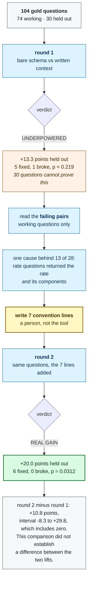

# Walkthrough: watching written context earn a number

[Documentation](README.md) / Walkthrough

## On this page

- [Run the recorded example](#run-the-recorded-example)
- [What is being measured](#what-is-being-measured)
- [Round 1: the tool refuses to claim anything](#round-1-the-tool-refuses-to-claim-anything)
- [The part that is actually the product](#the-part-that-is-actually-the-product)
- [Write the conventions](#write-the-conventions)
- [Round 2: the claim is earned](#round-2-the-claim-is-earned)
- [Read the gap before you celebrate](#read-the-gap-before-you-celebrate)
- [What this does not claim](#what-this-does-not-claim)
- [Your turn, on your own data](#your-turn-on-your-own-data)
- [Operational notes](#operational-notes)

Read one public theLook experiment: its inconclusive first round, the
working-set failures that motivated conventions, and the recorded comparison.

**Prerequisites:** Python 3.10+, Git, and the cloned repository. The local
reproduction reads committed answers and makes no model or warehouse calls.
For a new run, use [Evaluate your data](EVALUATE.md).

This is a historical experiment, including held-out readings from two rounds.
It does not model the current one-look holdout protocol. In a new evaluation,
curate on working questions and reserve the holdout for the final comparison.



<a id="run-it-offline-first-one-minute-no-key-no-cloud"></a>

## Run the recorded example

```
git clone https://github.com/moutasemalakkad/context-lift && cd context-lift
make example-thelook
```

That recomputes the committed round from its recorded answers:

```
verdict: REAL GAIN
  the held-out questions moved +20.0 points (p = 0.0312), and they were read once
  held out: 30 questions, +20.0 points, 6 fixed, 0 broke
  fit on the working questions: 52 questions, +30.8 points, 16 fixed, 0 broke
  no warehouse, no model, no network
```

The headline comparison is recomputed by `tests/test_readme_numbers.py`
from that same file, so a change to the statistics or to the verdict rules
fails a test rather than quietly moving a claim.

## What is being measured

Two arms over the same 104 questions.

| | what the agent is given |
|---|---|
| control | the tables, and the column descriptions the estate already had |
| treatment | all of that, **plus** what a person wrote down about the business |

The control is built first and the treatment is built **from** it, so the only
difference between them is the authored context. There is no way for a later
edit to give the control something the treatment lacks.

The questions are split once, by a hash of the question id and a seed, into
74 **working** questions and 30 **held-out** ones. You may look at the working
questions as much as you like. For a new run, read the held-out ones once, at the end. The historical
readings below are retained with their original results.

## Round 1: the tool refuses to claim anything

The original run used the public gold set and spec in `examples/thelook/`.
Its recorded setup used one repetition and made 208 model calls. Reproduce
the saved result offline above; follow the current evaluation guide to
estimate and run a new experiment with three repetitions per arm.

```
verdict: UNDERPOWERED
  30 held-out questions cannot show a 10-point lift even if nothing broke;
  about 60 would. Nothing here says the context does not help
  held out: 30 questions, +13.3 points, 5 fixed, 1 broke
```

Read the second line, not the word. **The held-out questions moved +13.3
points.** Five were fixed, one broke. The word is UNDERPOWERED because six
changed answers out of thirty is too few to rule out luck: the test gives
p = 0.219, and the bar is 0.05.

Most tools would print +13.3 and stop. That number would be quoted in a deck
by Friday. This one says what it would take to settle it: about sixty
held-out questions.

## The part that is actually the product

The round ends by counting the failures on the **working** questions:

```
what to write next, from the working questions:
  16 of 28 failures are COLUMN_COUNT: worked examples ...
  10 of 28 failures are WRONG_VALUES: a definition line ...
  This reads a count, not a cause. Read three failing pairs side by side
  before writing anything.
```

Take the last line seriously. It is the difference between doing this well
and doing it badly.

The count says: write sixteen worked examples. Reading the pairs says
something else entirely:

```
question: "return rate by department"
gold:     department, return_pct
model:    department, returned_items, non_cancelled_items, return_rate_percentage
```

Every rate, share and percentage question came back with the answer **and the
numerator and denominator it was computed from**. That is not sixteen
problems. It is **one convention**, and it fits on one line.

Nothing in the schema says which shape the business reports. A column called
`sale_price` does not say which sales count. This is exactly the knowledge
that lives in people's heads, and writing it down is what this tool measures.

## Write the conventions

Seven lines went into `examples/thelook/spec/rules/10-output-conventions.md`:

```
- A question asking for a rate, a share or a percentage returns the grouping
  column and the rate, and not the numerator and the denominator. [13 failures]
- Identify a product, a customer, a brand or a distribution centre by its
  name, not its numeric id. [3]
- Customer attributes come from the users table. The orders table carries a
  gender of its own and it is not the customer's. [1]
- A year in a question is the date the order line was created, unless the
  question names a different event. [1]
- Average markup is the average price minus the average cost, over the
  average cost. Not the average of the per-product markup. [1]
- Round money and percentages to two decimal places. [2]
- Customer age bands are exactly: "under 25", "25 to 39", "40 to 59",
  "60 and over". [1]
```

Before spending anything, the free checks run:

```
[ok] table coverage: 30 of 30 golds have every table they need in the arm (100%); the arm carries 7
[ok] pasted SQL: 0 of 43 rule lines contain a SELECT (0%)
[ok] template twin: none of 22 items share a query shape with the 30 scored questions
[ok] leak: 0 of 30 held-out questions appear in what the agent is handed
```

The leak check matters most. These rules were written while reading failures,
and the gate proves none of the held-out questions leaked into them.

**The first one is 100% here because this dataset has seven tables, and that
is exactly why it is worth explaining.** On a real estate it failed:

```
[FAIL] table coverage: 1 of 39 golds have every table they need in the arm (3%);
the arm carries 27. 58 table(s) the golds need are not in the arm:
arc_logs.arc_poet_event_tracker, dm_consumer_activity.tbl_gbl_ltc_visits ...
and 53 more
```

The questions were mined from the whole warehouse; the context spec described
27 tables from one project. So the agent was asked 38 questions about data it
had never been handed. It returned **no SQL at all for 55 of 78 answers**,
both arms failed identically, the lift was +0.0 on both halves, and the page
read UNDERPOWERED — which sends a reader off to find more questions when the
fix was a table list.

Comparing two sets of table names costs nothing. It is the first gate for
that reason: the cheapest and the most damning. It refuses below 60% rather
than below 100%, because a few uncovered golds dilute a measurement that is
still real, and a person may accept that knowingly.

## Round 2: the claim is earned

The recorded second round used the same questions and seed, with the
conventions added. It is a historical comparison, not an instruction to
repeatedly inspect a new holdout.

```
verdict: REAL GAIN
  the held-out questions moved +20.0 points (p = 0.0312), and they were read once
  held out: 30 questions, +20.0 points, 6 fixed, 0 broke
  fit on the working questions: 52 of 74 questions, +30.8 points, 16 fixed, 0 broke
  gap: +10.8 points [-8.3, +29.8], the working-set lift minus the held-out one.
  It includes zero, so there is no evidence the context fitted the questions
  it was written from
```

| | round 1 | round 2 |
|---|---|---|
| held out | +13.3, 5 fixed, **1 broke** | **+20.0, 6 fixed, 0 broke** |
| p | 0.219 | **0.0312** |
| verdict | UNDERPOWERED | **REAL GAIN** |

Seven written lines. Six held-out questions fixed, none broken.

## Read the gap before you celebrate

```
gap: +10.8 points [-8.3, +29.8] ... includes zero
```

The gap is the working-set lift minus the held-out lift. It answers the one
question that matters about rules written while staring at failures: **did I
just describe my own answer key?**

If the seven lines were only a description of the 74 working questions, they
would have helped those and done nothing for the thirty nobody looked at. The
working set would have jumped, the held-out set would have stayed flat, and
the verdict would read OVERFIT instead of REAL GAIN.

The interval includes zero, so this comparison does not establish a
difference between working-set and held-out lift. It also does not prove
that overfitting is absent.

## What this does not claim

Two things, stated because a walkthrough that only shows the win is an
advertisement.

**The honest sentence is "written conventions make the agent match the
business", not "the agent learned the business".** Several of those seven
lines resolve ambiguity in questions the author wrote. A business that
already has a semantic layer - LookML, dbt, Cube, Apache Ossie - has these
conventions declared once, and `contextlift semantic` reads them; a declared
metric beats a rule somebody has to remember to write.

**The same person wrote the questions and the context here.** That
circularity is real and the held-out split narrows it rather than removing
it. Questions from an independently reviewed query log reduce this source of
bias. See [Build the answer key](EVALUATE.md#3-review-and-split-the-answer-key).

## Your turn, on your own data

Follow [Evaluate your data](EVALUATE.md) for setup, estimates, review, and the
working-set loop. Expect UNDERPOWERED on your first round when the sample is
too small to resolve the intended lift; report the interval and broken IDs
alongside that conclusion.

## Operational notes

Costs and long-running-stage examples moved to [Field notes](FIELD-NOTES.md#costs-and-progress).

<details>
<summary>Links to the former sections</summary>

<a id="the-tool-prices-its-own-settings-instead-of-asserting-them"></a>

[The tool prices its own settings instead of asserting them](FIELD-NOTES.md#the-tool-prices-its-own-settings-instead-of-asserting-them)

<a id="what-you-will-see-while-a-long-stage-runs"></a>

[What you will see while a long stage runs](FIELD-NOTES.md#what-you-will-see-while-a-long-stage-runs)

<a id="when-one-item-hangs"></a>

[When one item hangs](FIELD-NOTES.md#when-one-item-hangs)

<a id="the-121-is-why-that-column-exists"></a>

[The `$1.21` is why that column exists](FIELD-NOTES.md#the-121-is-why-that-column-exists)

</details>

[Documentation index](README.md) · Next: [Evaluate your data](EVALUATE.md)
