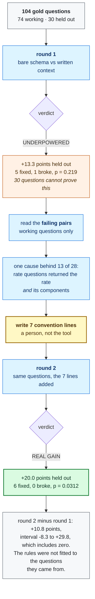

# Walkthrough: watching written context earn a number

This is the record of one real loop, on a public dataset, with every command
and what it printed. Run the offline parts yourself in about a minute and no
credentials; run the live parts for about fifty minutes and, until
2026-09-30, no money.

What you are about to watch is not "context helps, here is a big number". It
is a first round that **refused to claim anything**, the failures it printed
instead, and a second round that earned the claim.



## Run it offline first. One minute, no key, no cloud.

```
git clone https://github.com/moutasemalakkad/context-lift && cd context-lift
make install
make example-thelook
```

That recomputes the committed round from its recorded answers:

```
verdict: REAL GAIN
  the held-out questions moved +20.0 points (p = 0.0312), and they were read once
  held out: 30 questions, +20.0 points, 6 fixed, 0 broke
  fit on the working questions: 52 questions, +30.8 points, 16 fixed, 0 broke
  no warehouse, no model, no network
```

Every number in this document is recomputed by `tests/test_readme_numbers.py`
from that same file, so a change to the statistics or to the verdict rules
fails a test rather than quietly moving a claim.

## What is being measured

Two arms over the same 104 questions.

| | what the agent is given |
|---|---|
| control | the tables, and the column descriptions the estate already had |
| treatment | all of that, **plus** what a person wrote down about the business |

The control is built first and the treatment is built **from** it, so the only
difference between them is the authored context. There is no way for a later
edit to give the control something the treatment lacks.

The questions are split once, by a hash of the question id and a seed, into
74 **working** questions and 30 **held-out** ones. You may look at the working
questions as much as you like. The held-out ones are read once, at the end.
That split is the entire difference between a number and a story.

## Round 1: the tool refuses to claim anything

```
contextlift round \
  --golds examples/thelook/golds.csv \
  --spec examples/thelook/spec \
  --db bq://YOUR_PROJECT/bigquery-public-data.thelook_ecommerce \
  --project YOUR_PROJECT --k 1 --budget 5
```

208 calls, about fifty minutes. It prints its cost first and waits for you to
type `RUN`.

```
verdict: UNDERPOWERED
  30 held-out questions cannot show a 10-point lift even if nothing broke;
  about 60 would. Nothing here says the context does not help
  held out: 30 questions, +13.3 points, 5 fixed, 1 broke
```

Read the second line, not the word. **The held-out questions moved +13.3
points.** Five were fixed, one broke. The word is UNDERPOWERED because six
changed answers out of thirty is too few to rule out luck: the test gives
p = 0.219, and the bar is 0.05.

Most tools would print +13.3 and stop. That number would be quoted in a deck
by Friday. This one says what it would take to settle it: about sixty
held-out questions.

## The part that is actually the product

The round ends by counting the failures on the **working** questions:

```
what to write next, from the working questions:
  16 of 28 failures are COLUMN_COUNT: worked examples ...
  10 of 28 failures are WRONG_VALUES: a definition line ...
  This reads a count, not a cause. Read three failing pairs side by side
  before writing anything.
```

Take the last line seriously. It is the difference between doing this well
and doing it badly.

The count says: write sixteen worked examples. Reading the pairs says
something else entirely:

```
question: "return rate by department"
gold:     department, return_pct
model:    department, returned_items, non_cancelled_items, return_rate_percentage
```

Every rate, share and percentage question came back with the answer **and the
numerator and denominator it was computed from**. That is not sixteen
problems. It is **one convention**, and it fits on one line.

Nothing in the schema says which shape the business reports. A column called
`sale_price` does not say which sales count. This is exactly the knowledge
that lives in people's heads, and writing it down is what this tool measures.

## Write the conventions

Seven lines went into `examples/thelook/spec/rules/10-output-conventions.md`:

```
- A question asking for a rate, a share or a percentage returns the grouping
  column and the rate, and not the numerator and the denominator. [13 failures]
- Identify a product, a customer, a brand or a distribution centre by its
  name, not its numeric id. [3]
- Customer attributes come from the users table. The orders table carries a
  gender of its own and it is not the customer's. [1]
- A year in a question is the date the order line was created, unless the
  question names a different event. [1]
- Average markup is the average price minus the average cost, over the
  average cost. Not the average of the per-product markup. [1]
- Round money and percentages to two decimal places. [2]
- Customer age bands are exactly: "under 25", "25 to 39", "40 to 59",
  "60 and over". [1]
```

Before spending anything, the free checks run:

```
[ok] table coverage: 30 of 30 golds have every table they need in the arm (100%); the arm carries 7
[ok] pasted SQL: 0 of 43 rule lines contain a SELECT (0%)
[ok] template twin: none of 22 items share a query shape with the 30 scored questions
[ok] leak: 0 of 30 held-out questions appear in what the agent is handed
```

The leak check matters most. These rules were written while reading failures,
and the gate proves none of the held-out questions leaked into them.

**The first one is 100% here because this dataset has seven tables, and that
is exactly why it is worth explaining.** On a real estate it failed:

```
[FAIL] table coverage: 1 of 39 golds have every table they need in the arm (3%);
the arm carries 27. 58 table(s) the golds need are not in the arm:
arc_logs.arc_poet_event_tracker, dm_consumer_activity.tbl_gbl_ltc_visits ...
and 53 more
```

The questions were mined from the whole warehouse; the context spec described
27 tables from one project. So the agent was asked 38 questions about data it
had never been handed. It returned **no SQL at all for 55 of 78 answers**,
both arms failed identically, the lift was +0.0 on both halves, and the page
read UNDERPOWERED — which sends a reader off to find more questions when the
fix was a table list.

Comparing two sets of table names costs nothing. It is the first gate for
that reason: the cheapest and the most damning. It refuses below 60% rather
than below 100%, because a few uncovered golds dilute a measurement that is
still real, and a person may accept that knowingly.

## Round 2: the claim is earned

Same command, same questions, same seed. Only the context changed.

```
verdict: REAL GAIN
  the held-out questions moved +20.0 points (p = 0.0312), and they were read once
  held out: 30 questions, +20.0 points, 6 fixed, 0 broke
  fit on the working questions: 52 of 74 questions, +30.8 points, 16 fixed, 0 broke
  gap: +10.8 points [-8.3, +29.8], the working-set lift minus the held-out one.
  It includes zero, so there is no evidence the context fitted the questions
  it was written from
```

| | round 1 | round 2 |
|---|---|---|
| held out | +13.3, 5 fixed, **1 broke** | **+20.0, 6 fixed, 0 broke** |
| p | 0.219 | **0.0312** |
| verdict | UNDERPOWERED | **REAL GAIN** |

Seven written lines. Six held-out questions fixed, none broken.

## Read the gap before you celebrate

```
gap: +10.8 points [-8.3, +29.8] ... includes zero
```

The gap is the working-set lift minus the held-out lift. It answers the one
question that matters about rules written while staring at failures: **did I
just describe my own answer key?**

If the seven lines were only a description of the 74 working questions, they
would have helped those and done nothing for the thirty nobody looked at. The
working set would have jumped, the held-out set would have stayed flat, and
the verdict would read OVERFIT instead of REAL GAIN.

It includes zero. The rules helped questions never read about as much as the
ones they came from. That is what a real business convention looks like.

## What this does not claim

Two things, stated because a walkthrough that only shows the win is an
advertisement.

**The honest sentence is "written conventions make the agent match the
business", not "the agent learned the business".** Several of those seven
lines resolve ambiguity in questions the author wrote. A business that
already has a semantic layer - LookML, dbt, Cube, Apache Ossie - has these
conventions declared once, and `contextlift semantic` reads them; a declared
metric beats a rule somebody has to remember to write.

**The same person wrote the questions and the context here.** That
circularity is real and the held-out split narrows it rather than removing
it. Only questions from a real query log remove it, which is what
`contextlift mine --from-jobs` is for on an estate with traffic.

## The tool prices its own settings instead of asserting them

A flag with a number in it is a judgement somebody made, and until it is
priced nobody can argue with it. Two of them print what a different choice
would buy, computed from figures the run already has, so neither costs an
extra query.

The byte ceiling. `--max-bytes` refuses a query whose dry run scans more than
it, and on a warehouse of any size the 1 GB default refuses a lot:

```
  what raising --max-bytes would buy (it was 1 GB):
    --max-bytes 10     GB   61 of 112 come back, 0.28 TiB to run once, ~$1.74
    --max-bytes 200    GB   93 of 112 come back, 2.08 TiB to run once, ~$12.99
    --max-bytes 2000   GB   111 of 112 come back, 20.55 TiB to run once, ~$128.45
    one shape wants 29,546 GB on its own, 17x the next largest (1,766 GB): a
    ceiling that includes it is paid for one gold
```

That last line is the point. Without it you read "111 of 112" and pay $128
for one extra question.

The question-literal cap. `--max-question-literals` drops a drafted question
carrying more than N quoted values, because six product codes and an order
number is one analyst's own lookup, not a question anyone else asks. The
default is 2, and the run says what 3 would cost:

```
  what a looser --max-question-literals would buy (it is 2):
    --max-question-literals 3   39 of 84 dropped questions come back
    --max-question-literals 6   72 of 84 dropped questions come back
    the largest carried 35 quoted values, which is the kind of question the
    cap is for: one analyst's own lookup, not a question anyone else asks
```

Neither ladder changes anything by itself. They exist so a setting is a
decision you made with the numbers in front of you.

## What you will see while a long stage runs

`mine` makes one model call and one warehouse query per shape. On a real
estate that is 500 shapes and about 90 minutes. Every 25 items it prints one
line, appended, never a repainted bar:

```
mine       2m14s  [####------------]    100/437   eta 7m31s  $1.21
                  clean 61  over-budget 14  no-access 8  gone 5  bad-sql 3
```

The top line is where it is, how long is left, and what it has cost. The
second line is the part worth watching: it is a live answer to "is my query
log any good". `clean 61` means 61 usable answer keys so far. The rest are
named for **what recovers them**, not for what broke:

| name | meaning | what to do |
|---|---|---|
| `over-budget` | the ceiling turned it away before it ran | raise `--max-bytes` |
| `no-access` | a 403; the platform refused the call | ask whoever owns the policy |
| `gone` | names a table that was dropped | nothing; the gold goes |
| `not-a-question` | `SELECT *`, or `LIMIT` with no `ORDER BY` | nothing; it has no single right answer |
| `no-rows` | it runs and returns nothing | any wrong SQL also scores right on it |
| `bad-sql` | the SQL itself is wrong | read `gate_detail` |

A bar is never full until the stage is done, and `eta` reads `?` until there
is a rate to measure.

### When one item hangs

If a single item stops responding, the counting line cannot help you: it is
printed once per item, so an item that never finishes produces no line at
all. A separate heartbeat covers that case, and it says the two things that
diagnose a hang:

```
mine       3m53s  [###########-----]    100/150   eta 1m56s  $0.74
                  clean 22  over-budget 14  no-access 16  gone 18
mine       6m15s  [##########?-----]    101/150   stuck 3m28s  3 model retries (429), 1m02s waiting
```

Same columns, so you can read down. Two differences, both deliberate. The
bar carries a **`?` at the item being waited on**, so the line is visibly
about one item rather than the whole run. And where an eta would be it says
**how long this one item has taken** — an eta there would be a lie, because
the rate it is computed from has stopped.

The text after it is what the stage knows about its own calls. `3 model
retries (429)` means the model answered "too many requests" three times and
the tool waited between tries; `0 retries` is also printed, because "this is
slow and nothing is being retried" is a different problem from "this is
being throttled" and you cannot tell them apart by watching.

This exists because of a run that went silent for **six minutes and fifteen
seconds** with a time-based throttle already in place and working exactly as
written. The throttle was checked once per item, so it was a clock that could
only be read while things were already moving.

### The `$1.21` is why that column exists

`mine` checks what it has billed between shapes and stops at `--budget`,
keeping everything it found. The reason it watches the real spend rather than
trusting the estimate is that a mine's cost is concentrated in a few queries
and the estimate is not reliable in either direction. Measured on one
enterprise warehouse, 45 minutes into a 500-shape run:

| queries | size | share of the bill |
|---|---|---|
| 11 | over 10 GB | **$1.39** |
| 21 | 1 to 10 GB | $0.52 |
| 14 | under 1 GB | $0.02 |
| 42 | free (dry run or table probe) | $0.00 |

Two things to read off that. **11 queries of 88 were 72% of the bill**, each
near the `--max-bytes 50GB` ceiling, the largest scanning 48 GB. And **42 of
the 88 jobs cost nothing at all**: a dry run is free, and so is the
`SELECT 1 FROM t LIMIT 1` probe that checks whether a table still exists. So
a job count says almost nothing about a bill.

The dry run estimated $8.89 for that run. It billed $1.94, about a fifth. The
dry run prices the scan BigQuery can predict before it runs, and partition
pruning and the result cache then cut the real bill. It can also be too low.
An estimate is a useful warning and a bad ceiling, which is why `--budget` is
now checked twice: once against the estimate before starting, and again
against what has actually been billed, between shapes.

Those four rows are recomputed from the run's own job history by
`tests/test_mine_cost_bands.py`, which fails if this table drifts. It has
caught this table being wrong twice, and both mistakes are worth knowing:

- The figures were first computed by dividing bytes by 10^12 and pricing the
  result per TiB, which overstates by 10%.
- Worse, they were first pulled **by time window alone** from a shared
  production project. 623 of the jobs in that window belonged to other people
  querying the same project, and $13.40 of the $15.34 was their spend. This
  table said $10.84 for a run that cost $1.94. Filtering by the account that
  ran the mine gives the 88 jobs above.

That second mistake is the argument for the `app=context-lift` job label on
every query this tool runs. With the label, the first query would have been
right. See [ATTRIBUTION.md](ATTRIBUTION.md).

That gap is normal and it is why the estimate cannot be the only guard: a
dry run prices the scan BigQuery can predict, and a real scan can come in
above it. So `--budget` is checked before the run against the estimate and
again between shapes against what was actually billed. When it stops you get:

```
STOPPED ON BUDGET after 137 of 500 shapes: $25.04 billed against --budget $25.00
  every count below is over the shapes it reached, not over the log.
  The shapes are ranked, so what it reached is the top of the ranking.
```

Read that first line before any other number in the summary. A stopped run
sampled the top of the ranking, so `clean 22` means 22 clean out of the
shapes it reached, and says nothing about the rest of your log.

The review file is written **as each candidate is found**, not at the end,
so you can open it in another terminal while the run continues, and a run you
kill keeps its work. The cheapest way to fit a big log under a budget is to
lower `--max-bytes` rather than to raise the ceiling: the summary's
over-budget ladder prices each step for you.

## Your turn, on your own data

The commands are in [QUICKSTART.md](QUICKSTART.md) section 3, starting from a
warehouse rather than from an answer key you do not have yet. One thing from
that section is worth repeating here, because it is the mistake that cost two
customer rounds:

**Filter the log before you mine it.** `contextlift log` keeps the busiest query
shapes, and a dashboard tile runs hundreds of times for one viewer. Measured
on one enterprise warehouse over its own 180 days: 1,205,904 successful
SELECTs, 290,940 with a `GROUP BY`, and 29,684 that also named two or more
tables. That last group is 2.5%, so a top-2,000 pull by traffic held 42 of
them, and of the 75 answer keys it produced, **two** joined two tables and
aggregated. The rest were dashboard tiles and single-table KPIs.

No written business rule can change the answer to `SELECT
ANY_VALUE(latest_week_text) ... WHERE timeframe = '?'`. So 97% of that gold
set could not move however good the context was, two rounds on it proved
nothing, and the cause was in the very first command. With `--min-tables 2
--require-analytical`, the same 2,000 rows held 1,494 analytical shapes.

Expect UNDERPOWERED on your first round even so. A customer estate usually
yields 50 to 90 questions, and 24 held-out questions can only prove a lift
above about 20 points. That is not the tool failing; it is the tool telling
you what your evidence can carry. The page prints how many questions would
settle it.
