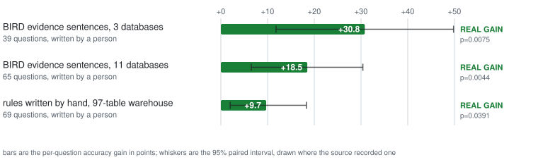

<!-- SPDX-License-Identifier: Apache-2.0 -->
<!-- SPDX-FileCopyrightText: 2026 Moutasem Akkad <moutasemalakkad@gmail.com> -->

# Research archive

Recorded measurements, their limitations, and corrections. For the current
workflow, follow the [guide](../README.md). Commands quoted here describe
historical experiments; they are not instructions to reopen a holdout.

Use [examples](../../examples/README.md) for benchmark-specific reproduction.
Committed receipts can be checked offline. Older campaign and field figures
whose raw data is private are labeled accordingly; their analysis scripts do
not substitute for the missing raw data.

## Contents

- [The recorded theLook loop](#thelook-the-loop-closing-2026-09-10)
- [Benchmark results](#benchmark-results)
- [Evidence behind the practices](#1-choose-a-scope)
- [Context perturbations](#context-perturbations)
- [Removing context classes](#removing-context-classes)
- [Operational findings](#operational-findings)
- [Measurement corrections](#measurement-corrections)
- [Open research](#open-research)

## thelook, the loop closing, 2026-09-10

Recompute the committed second-round comparison with `make example-thelook`.
It reads [answer-level rows](../../examples/thelook/committed/run-2026-09-10.csv),
without a model call or a warehouse query. The historical first reading was:

```text
verdict: UNDERPOWERED
  held out: 30 questions, +13.3 points, 5 fixed, 1 broke
```

Six changed answers could not rule out chance: p = 0.219. Reporting +13.3
without the refusal would overstate the result. Expect UNDERPOWERED on your
first round if its set cannot resolve the target effect.

On the working questions, 16 of 28 failures were column-count mismatches.
Inspection found rate answers carrying an extra numerator and denominator.
Seven convention lines later, the recorded second comparison printed:

```text
verdict: REAL GAIN
  held out: 30 questions, +20.0 points, 6 fixed, 0 broke
  p = 0.0312
  fit on the working questions: 52 of 74 questions, +30.8 points, 16 fixed, 0 broke
  gap: +10.8 points [-8.3, +29.8]
```

The working-set comparison excludes 22 stored-example lookups. The gap is
working lift minus held-out lift; its interval includes zero. That does not
prove an absence of overfitting.

**Historical limitation:** this sequence contains two holdout readings. The
second result's recorded verdict does not make repeated holdout inspection a
valid procedure for a new experiment. The current guide reserves one final
paired reading after curation. Also, the same person wrote the questions and
the context. The result concerns matching those conventions, not "the agent
learned the business". Log-derived questions and independent review are needed
to test transfer beyond author-written questions.

## Benchmark results

<picture>
  <source media="(prefers-color-scheme: dark)" srcset="../assets/results-dark.svg">
  
</picture>

The [chart data](../assets/results.json) names each source and its numerical
test. These experiments use different models, questions, and conditions;
their point estimates are not a ranking of approaches.

### Later enterprise trials

The [BEAVER receipt](../../examples/beaver/result.json) records a 266-of-1,200
gate, -0.7 points from broad rules on development, and +12.8 from verified
examples on an inner split. Its final paired reading retained 69 questions:
+9.7 points [+2.0, +18.3], 8 fixed, 1 broken (`dw_247`), p = 0.0391.
Three template twins were banned before that reading.

The [BIRD enterprise receipt](../../examples/bird/enterprise_result.json)
records a policy selected on development and frozen for a new reserved set.
Coverage was 25.4% (65 questions). The question-level lift was +18.5 points;
the pooled-answer estimate was +19.5. The report lists 15 stable fixes and
3 stable regressions, and its routing uses annotated gold tables. This is an
oracle-routing result on the covered cohort, not a measured end-to-end router.
The benchmark README retains the exact intervals, IDs, and exclusions.

An earlier TPC-DS stress-test note reported +1.7 points on 20 reserved
questions, with zero stable fixes and zero stable breaks from retry. No
committed answer-level artifact accompanies that note; treat it as a
historical, underpowered observation. Execution failures becoming executable
but wrong answers would require semantic investigation, not a claim of gain.

### Earlier campaign, 2026-08-30 to 2026-09-01

This historical campaign used gemini-2.5-flash unless marked pro. Its full
logs and predictions are in a private archive because of dataset/artifact
terms. These figures are retained as the campaign record, not independently
recomputed by the small public demo. Later committed examples provide the
public reproduction entry points.

| Benchmark | Databases | Usable golds | Schema-only accuracy |
|---|---:|---:|---:|
| KaggleDBQA | 8 | 266 of 272 | 46.2% |
| Spider 2.0-lite local | 16 | 24 of 24 | 20.8% |
| BEAVER DW, 2025 | 1 | 96 of 121 | 3.8% |
| BEAVER NW | 5 | 72 of 88 | 2.8% |

KaggleDBQA's supplied column documentation moved the pooled score +5.4 points
(p = 0.000006). On the larger 2026 BEAVER release, 2,015 of 5,787 questions
passed the gate, split into 1,419 working and 596 reserved questions. Its
historical ladder was:

| Arm | Accuracy | Qualification |
|---|---:|---|
| Schema only | 3.8% | Baseline |
| Iterated glossary | 5.7% | Four edits; the first broke three questions |
| Stronger model | 8.1% | p = 0.004 |
| Oracle table/join hints | 13.3% | Uses gold annotations; not a deployable router |
| Leak-checked example bank | 20.2% | p < 0.0001; pooled fixed 282 / broke 19 |

The final bank banned 47 template twins. Similar templates may still limit
transfer to novel questions. Schema retrieval, extra thinking, and retry each
moved +0.0 in the recorded working-set tests; value dictionaries moved +0.6
(p = 0.37), and consensus +1.0 (p = 0.11). These were findings about this
campaign, not universal rankings of curation methods.

An early BigQuery theLook pilot on 18 working questions reported +50.0 points
[+21.5, +67.4], 8 fixed, 0 broken, p = 0.0078, at $0.34 for its loop. It was
a working-set observation. For current public results and caveats, use the
benchmark READMEs linked above.

## 1. Choose a scope

**Field observation; raw estate data is private.** A spread sample had 36
questions over 59 tables and 60% of reserved questions shared tables with the
working set. A scoped sample had 43 questions over 13 tables and 100% reachable.
The public comparison had 104 questions over 9 tables. The reusable analysis
is `scripts/estate_shape.py`; reachability is a coverage check, not proof of
statistical power. Choose scope from demand and an owner-approved workload.

## 2. Check where documentation exists

**Field observation; raw estate data is private.** Only 6 of 43 golds read
documented datasets, while 300 KB of writing covered 27 other datasets.
`scripts/doc_coverage.py` found 72 of 758 candidates touching documentation,
24 of them passing the gate. Twelve documented products had no analytical
query in 180 days while the five busiest lacked documentation. Demand and
document coverage answer different questions; inspect both before mining.

## 3. Check resolution before spending

Four unanimous disagreements give exact p = 0.1250; five give 0.0625; six
give 0.0312. Six is the smallest unanimous set that can cross 0.05. One field
round had 1 fixed and 3 broken, p = 0.6250. A real effect can remain unresolved
on a small set; neither repeated model calls nor optimistic wording creates
new independent questions. See `scripts/resolvable_lift.py` and
`tests/test_power.py` for the calculation.

## 4. Separate lift, regressions, and cost

**Field observation; raw estate data is private.** One round read NOT PROVEN,
with 1 fixed and 3 broken out of 29 reserved questions, while bytes rose
30.4%: 169.0 to 220.4 GB on 36 paired questions. Seventeen queries got cheaper
and thirteen dearer (sign-test p = 0.5847). The total rose because of a few
large queries, including one 30.17 GB increase. A verdict, an observed break
count, and an observed bill are three separate results.

## 5. Name the subject

**Field observation; accuracy benefit not established.** Five of ten drafted
rules failed to name the metric being computed; eight of ten bare column
names belonged to no table in the arm. A reviewer should supply the subject
and verify the columns. The later perturbation measurement below downgraded
unknown-column lint from REFUSE to WARN: prevalence did not prove cost.

## 6. Scope the rule

**Hypothesis with an observed mechanism.** An estate-wide fiscal rule moved
one question onto a wrongly joined date table, adding 30 GB and losing one
correct answer. A table-scoped wording might prevent it; that edit was not
measured. In a catalog, a table rule belongs in the table's `overview`; broader
conventions belong in the rules file or spec repo delivered with the request.

## 7. Confirm inferred conventions

**Unproven advice.** A frequent query pattern is evidence of use, not an
owner-approved definition. The field failures above motivated this review
step; no isolated arm has measured its accuracy benefit. Prefer a definition
the data owner can defend and record the source of any inferred convention.

## 8. Distinguish parameters from business codes

**Field observation.** Of 43 golds, 23 pinned an ISO date. Twenty of those
already stated the date in the question; only three omitted it, all using
`9999-12-31` as a sentinel. Counting every date as a missing parameter would
overstate the problem. `scripts/regate_literals.py` reproduces the check when
given the private candidates. A rule should not invent an arbitrary period.

## 9. Review the key independently

**Advice, with the framework's own observed failure:** the two pulls in
practice 11 rejected 140 of 372 drafted questions for not matching their SQL.
Model-reviewed acceptance does not establish the remaining error rate.
Keep the model-review caveat until a person audits the rows; do not silently
upgrade a draft to a human-reviewed gold.

## 10. Measure a model change as its own arm

The historical BEAVER ladder moved from 5.7% to 8.1% with a stronger model,
+2.4 points (p = 0.004). That is one observed intervention, not evidence that
model choice is always irrelevant. Keep a model change separate from a rules
change so a gain can be attributed to the intervention you intended to test.

## 11. Check drafted questions against SQL

**Field observation, 2026-09-12; raw rows are private.** A separate model
reviewed two pulls: 45 of 177 candidates and 49 of 195 were kept. In total,
140 of 372 were rejected because the English did not ask what the SQL answered.
Those queries had executed and passed SQL checks. Query validity had not
established question validity.

`scripts/redraft_worksheet.py` extracts rejected rows and restores analyst
comments as review material. Review four properties together: same answer,
explicit arbitrary parameters, business meaning expressed in ordinary words,
and no leaked definition when that definition is the context being tested.

## 12. Reconcile the bill

**Historical field incident.** Printed spend totaled about $74 while a
user-filtered warehouse ledger showed $149.61 across 2,686 jobs. Predicted SQL
was missing from the estimate. `round --cost` subsequently gained job-ledger
reconciliation, cost per answer, and cost per correct answer. Missing jobs
must be reported as missing, not zero. `tests/test_cost_reconciliation.py`
keeps the $74-versus-$149.61 mismatch as a case that must fail reconciliation.

## 13. Measure example banks

The 2026-09-12 theLook class-removal run reported examples at -24.3 points
[-34.8, -13.9], 19 fixed and 1 broken by removal. Rules were +12.2 points
[+3.0, +21.3]; terms +1.4 and descriptions -0.0 were unresolved. These were
74 working questions and one repetition; the later committed class-removal
receipt below is the independently checkable follow-up.

The bank had 22 examples and about one-third question coverage. This suggests
testing a targeted bank, not concluding all examples hurt: the larger BEAVER
campaign's leak-checked bank added +6.9 points over its previous rung.
In a catalog, examples use the queries aspect. Route and leak-check them as
their own arm rather than assuming more examples must help.

## 14. Inspect the description share

Source: Looker's public theLook project at commit `88d68c3`, dated 2022-02-09.
The [extracted arm](../../examples/thelook/lookml-arm/README.md) contained
9 metrics, 0 with a written description (0%), 38 undescribed dimensions,
and 6 join paths. Its [recorded run](../../examples/thelook/lookml-arm/round-2026-09-12.txt)
printed:

```text
verdict: NOT PROVEN
safety: MIXED
  4 fixed, 2 broke, of 102 on the held-out questions
  broke: tl018, ta002
  held out: 102 questions, +2.0 points
  p = 0.6875
  arms 2404ed0d5166 against c6266a145763, K=1, 208 answers scored
```

MIXED, not SAFE: two previously correct questions broke. This is a trade, not a win.
The claim is conditional on the description share in this one project;
it does not establish that semantic layers fail. The earlier discussion cited
Cube, dbt Labs, and Shkapenyuk as work involving other forms of business
context. Those systems, question sets, and interventions differ from this
extraction, so their results cannot establish what a richer LookML arm would do.

Run `semantic --lookml DIR` to inspect the writing actually available before
selecting a BI model as the context source. Formulas and join paths alone
need not state the business convention the agent is missing.

## 15. Test reference selection

**Recorded 2026-09-13, 450 BIRD questions across three databases, three reps.**
The blob arm received all reference sentences for its database. Selection
received the question's own annotated sentence: **oracle retrieval**, supplied
with the answer key. This is an annotation-selection advantage no ranker can
obtain from hidden gold labels in deployment; it does not prove a learned
retriever could never choose a more useful bundle.

Source: `docs/evidence/blob-vs-selection.txt`;
[full receipt](../evidence/blob-vs-selection.txt).

```text
blob:      42.9% [40.3%, 45.5%], 6,711 prompt tokens per call
selection: 41.3% [38.7%, 44.0%],   822 prompt tokens per call
  lift            :  -1.6%  [-5.6%, +1.1%]
    fixed 25 / broke 35 of 450 questions
    p = 0.2451   not significant at 0.05

toxicology only:
  lift            :  -7.7%  [-15.7%, -1.6%]
    fixed 7 / broke 19 of 139 questions
    p = 0.0290   significant at 0.05
```

The negative sign means selection scored lower than the blob. The pooled
effect was unresolved; toxicology showed a loss. This does not establish a
universal preference for whole-context prompts, especially when an estate's
context will not fit. It supports measuring selection rather than assuming
focus helps. In a catalog, shared conventions can remain in a rules file
delivered with the request.

### Proposed mechanism and failed alternatives

The hypothesis was that one sentence made an unrequested column too salient.
`scripts/salience_counts.py` computed the following from
`docs/evidence/over-salience.txt` ([receipt](../evidence/over-salience.txt)):

```text
blob           74 of 417 runs
selection      97 of 417 runs
sentence names it    12 of 61  broke  (20%, n=61)
sentence does not     7 of 78  broke  (9%, n=78)
two-sided Fisher exact p = 0.0839
```

The two comparisons point the proposed way, but neither reaches significance.
The `label` column in the SELECT list was the signal; naming it in a correct
WHERE predicate is different. An assigned, matched-sentence experiment has
not been run, so over-salience remains unproven.

The breadth explanation predicted broken questions would name values found
nowhere else. Of the 19 broken questions, **0** do. A second hypothesis blamed
misspelled literals. The repair arm stated its own kill condition before it ran:
toxicology needed +2 points. It moved +1.0. Source:
`docs/evidence/repaired-literals.txt` ([receipt](../evidence/repaired-literals.txt)).

```text
  lift            :  +0.6%  [-0.8%, +3.5%]
    fixed 15 / broke 9 of 450 questions
    p = 0.3075   not significant at 0.05
```

The typo is not supported as the explanation. Repairing unambiguous case or
whitespace mistakes is useful hygiene, but this result is not worth claiming as lift.
Eliminating alternatives does not prove the remaining hypothesis.

**Correction:** hand counts had claimed 37 select-list mentions against 9,
and a 29%-versus-5% break rate. Neither survived being computed by a program.
The committed counts above replace them.

### Asking the agent to request more context

Source: `docs/evidence/self-route.txt` ([receipt](../evidence/self-route.txt)).

```text
strict wording    2 of 139 escalated   1.4%
soft wording      not recoverable
```

The soft arm was overwritten by reusing its output path. Its approximate
rate is not a result that can be checked. The surviving strict run shows low
escalation in this setup, not a general inability to request missing context.

## 16. Measure cache usage rather than assuming savings

The 2026-09-13 probes used a recorded 2,048-token Flash cache threshold.
Toxicology's blob averaged 6,606 prompt tokens per call and selection 411;
the across-database averages in practice 15 use a different denominator.
The small arm was below the threshold in this experiment. Per-question
context is not universally uncacheable: a sufficiently long shared prefix can
still qualify, depending on the service and request layout.

Two probes with input identical to the token disagreed:

| Probe | Prompt tokens | Cached tokens | Observed share |
|---|---:|---:|---:|
| 1 | 165,128 | 18,340 | 11% |
| 2 | 165,128 | 30,566 | 19% |

Source: `docs/evidence/cache-probes.txt` ([receipt](../evidence/cache-probes.txt)).
**No hit rate is claimed** as a stable property of this prompt. Eligibility
and observed billed usage are separate facts; request timing and concurrency
matter. Check current backend prices before a new paid run.

## What is still unproven, stated plainly

Practices 6 and 7 are hypotheses, not measured interventions. Practice 5
documents prevalence, not the accuracy cost of the defect. Practice 4's
direction across individual query costs is unresolved. The over-salience
mechanism in practice 15 remains unproven, and practice 16 establishes no
stable cache-hit rate. These public and private field observations do not
establish the effect of a customer's own authored context on new questions.

## Context perturbations

The first suite on theLook's 74 working questions removed a known useful
capitalisation rule. It moved -4.1 points, smaller than the set's resolvable
change (`power.smallest_resolvable(74)`). A suite that cannot resolve its own
control cannot price smaller defects. Source:
`docs/evidence/perturbation-positive-control.txt`.

The BIRD suite used 450 questions. The first run had one repetition per arm,
explicitly labeled a single sample, not a measurement. Its receipt is
`docs/evidence/perturbation-bird.txt`:

```text
defect                                  lift    95% interval        ruling
positive-control-drop-value-decoding  -18.9%  [-23.3%, -14.5%]   REAL LOSS
irrelevant-context                     -2.9%  [-6.0%,  +0.2%]    NOT PROVEN
strip-subject                          -2.7%  [-6.1%,  +0.8%]    NOT PROVEN
conflicting-definitions                -1.1%  [-4.5%,  +2.3%]    NOT PROVEN
unknown-column                         -0.2%  [-3.2%,  +2.8%]    NOT PROVEN
```

The control broke 102 questions and fixed 17. Unknown-column instructions
were mostly *ignored*, not obeyed; this changed the linter from REFUSE to
WARN. Frequency of a defect did not establish its accuracy cost.

The suite was run again at three repetitions, 1,350 observations per arm.
Source: `docs/evidence/perturbation-bird-3reps.txt`
([receipt](../evidence/perturbation-bird-3reps.txt)).

```text
defect                     1 rep    3 reps
positive-control           -18.9    -17.0
irrelevant-context          -2.9     -0.3
strip-subject               -2.7     -1.8
conflicting-definitions     -1.1     -1.3
unknown-column              -0.2     +0.2
```

The control held: -17.0 points [-21.5, -13.1], 92 questions broken against
14 fixed. The four realistic defects remained unresolved.

**A withdrawal, and it was mine.** The earlier write-up treated irrelevant
context's -2.9 estimate as a lead. At three reps it was the **least** harmful
of the four, at -0.3 with an interval reaching +3.8. The lead is withdrawn.
The original author recorded the mistake as “I quoted the point estimate
anyway”: an interval already spanning zero was noise being read as a ranking.

These results could mean the defects have small effects **or** that 450 questions cannot see them.
Resolving the observed +0.2
would need more than 5,000 questions. These are one model's public-data
perturbations, not measured costs on every estate.

## Removing context classes

The 2026-09-14 theLook run removed one class at a time, changing no other
condition. Reproduction entry: `make classes-thelook PROJECT=<project>`.
This is paid; estimate and approve a budget before executing it. Evidence:
`docs/evidence/classes-thelook-cost.txt`
([receipt](../evidence/classes-thelook-cost.txt)).

```text
class removed             contribution of class, 74 working questions
examples                  -27.0 points [-37.8, -16.2], 21 fixed 1 broke by removal
terms                      -2.7 points [-9.2, +3.8], not shown either way
authored descriptions      -1.4 points [-5.9, +3.2], not shown either way
rules                      +5.4 points [-5.1, +15.9], not shown either way
```

A negative number means the arm scored **better without that class**. These
22 worked examples were costing 27 points and were the only one of the four
rows that clears its own floor. The other classes were not shown either way,
which is not the same as costing nothing.

```text
0 full arm     $0.0107  $0.0001/answer  $0.0004/correct answer
minus examples $0.0113  $0.0002/answer  $0.0002/correct answer
```

Removal **raised** the query bill but **halved** the cost per correct answer.
Cost per answer alone calls that arm more expensive. Both cost axes matter.
These dollars are warehouse SQL only; model calls are a separate bill.

It is not a claim about worked examples generally: this was one model, one
seven-table schema, and one repetition. The earlier 24.3 points of loss from
the same broad bank and the BEAVER gain motivate testing relevance and bank
composition, not banning examples everywhere.

## Operational findings

### Gate failures sent to the right owner

Of 446 private field candidates, 179 once shared an `EXEC_FAIL` label.
The anonymized [error-shape fixture](../../tests/fixtures/exec_fail_details.json)
and `tests/test_exec_fail_split.py` reproduce the actual split:

| What happened | Rows | Response |
|---|---:|---|
| Byte cap refused the scan | 112 | Review cost, narrow scope, or explicitly raise cap |
| Platform policy denied access | 34 | Ask the policy owner |
| Table no longer existed | 24 | Remove or rebuild the gold |
| SQL execution problem | 9 | Inspect SQL and parameters |

The original SQL was not intrinsically wrong in 170 of 179 cases. Raising a
cap is a cost decision, not the default fix for all execution failures.

### Mining cost concentrated in a few queries

The committed [billed-byte fixture](../../tests/fixtures/mine_cost_bands.json)
is checked by `tests/test_mine_cost_bands.py`:

| Queries | Size | Bill |
|---|---|---|
| 11 | over 10 GB | **$1.39** |
| 21 | 1 to 10 GB | $0.52 |
| 14 | under 1 GB | $0.02 |
| 42 | free (dry run or table probe) | $0.00 |

The dry run estimated $8.89; actual cost was $1.94. Eleven of 88 jobs made
most of the bill. This dated observation explains why both per-query caps
and actual-spend checks matter; it is not a cost estimate for another estate.

### Repetitions and service behavior

Two historical 26-question runs, K=1, produced zero identical SQL answers
among 52 question/arm pairs, but only two correctness changes. One question
flipping in opposite directions moved the working lift from +10 to +20
points. SQL text stability and score stability are different measurements.

Private deployment notes recorded a 30-table CA arm taking 15–28 seconds per
question and an 85-table arm taking 60–210 seconds, with zero retries. The
heartbeat and timeout changes were motivated by those observations. They are
not service latency guarantees. Checkpointing, bounded rows, and explicit
split files preserve work without silently changing the compared questions.

Catalog payload and glossary round-trip receipts now live beside the relevant
[integration reference](../REFERENCE.md#recorded-catalog-verification).

## Measurement corrections

- **Comparator literature, 2026-09-12.** The former methodology attributed
  2.5% / 8.1% false negatives to single-database execution match. Those figures
  describe SQL text matching. The cited
  [test-suite paper](https://aclanthology.org/2020.emnlp-main.29/) instead
  reports single-database denotation false positives in Table 2. The optional
  one-sided judge cannot correct false positives and is not a certification.
- **Cost attribution.** Dividing bytes by decimal TB while pricing TiB
  inflated an early table. Filtering a shared project's jobs only by time
  also assigned other people's spending to this run. The $10.84 claim was
  replaced by the fixture-backed $1.94 above; use labels and job IDs.
- **Salience counts.** Practice 15 retains the withdrawn hand counts beside
  the recomputed values. The proposed mechanism is still unproven.
- **Perturbation ranking.** The one-repetition lead was withdrawn after three
  repetitions; the original and follow-up remain together above.
- **Cache wording.** The old universal claim that per-question snippets can
  never be cached was too broad. The measured small arm was below its dated
  threshold; this does not describe every request's shared prefix.
- **Catalog equivalence.** Equal payload hashes establish the bytes delivered.
  They do not guarantee equal answers from a model. The full file spec and
  writable catalog subset can also differ.

## Open research

The next useful validation is an independent, log-derived question set with
owner-reviewed context, a recorded baseline, and one reserved comparison.
Choose a cold-run dataset before seeing results, preserve unsuccessful arms,
record actual spend, and publish only artifacts permitted by the data terms.
Do not search repeatedly for a dataset that produces a gain.

A useful research record contains the reviewed scope, answer-key audit,
split, context versions, saved reports, regressions, costs, and the reason
an experiment stopped. Broader corpora, stronger power, two-sided human
audits, and controlled mechanism tests remain open. An inconclusive result
with those artifacts is more useful than an unsupported general claim.

[Return to the practical guide](../README.md).
